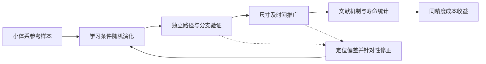

# 核心主线与文章证据链

> 最新状态：[2026-10-19进展与正式目录入口](CURRENT_PROGRESS_20261019.md)。当前物理路径准确性未认证，计算已停止，不自动恢复；下文保留已确认合同与决策历史。

> 当前执行顺序集中于[2026-09-23优先级实施清单](IMPLEMENTATION_CHECKLIST_20260923.md)，不以不断追加的历史段落作为并行任务矩阵。本轮整理未启动实验。

> 2026-09-23首轮实施确认：[Bauer开放链最小闭环](MULTISCALE_STOCHASTIC_PATH_ARCHITECTURE.md#bauer-minimal-loop-20260923)。先审计复用已有数据，在有可测量演化的有限窗建立局域等变基线，独立分项评估后逐项改进；未通过则定位原因，不自动扩大预算或矩阵。最终尺寸推广和多体系目标不变。

> 2026-09-22方法证据确认：[三组核心对照](MULTISCALE_STOCHASTIC_PATH_ARCHITECTURE.md#method-evidence-20260922)分别检验多尺度空间、联合时间生成及能量辅助的实际作用。当前为待验证贡献，保留负结果与交互作用边界；架构组合本身不构成有效性或文献新颖性证明。

> 2026-09-22效率确认：[同精度效率与成本回收合同](MULTISCALE_STOCHASTIC_PATH_ARCHITECTURE.md#efficiency-contract-20260922)。分别报告单条延迟、批量吞吐和包含数据／训练／验证的总成本，LLG允许合理并行；未达物理统计精度不能声称该精度下加速，前期回收须使用一致成本单位。

> 2026-09-21推广验证确认：[尺寸、时间及联合推广合同](MULTISCALE_STOCHASTIC_PATH_ARCHITECTURE.md#transfer-validation-20260921)。先同窗只扩大尺寸，再在已验证尺寸延长时间，最后联合推广；大体系对照同条件大体系LLG，不要求复现小体系统计。文献观测量是外部证据，不替代独立路径统计验证。

> 2026-09-21不确定性确认：[抽样误差与选模证据合同](MULTISCALE_STOCHASTIC_PATH_ARCHITECTURE.md#uncertainty-contract-20260921)。真实涨落与估计精度分开，按独立轨迹／来源组评估；数值误差、训练随机性、模型偏差另报。窄区间或区间含零不自动证明正确，使用预先确认容差和分项独立开发证据。

> 2026-09-21能量与事件确认：[能量统计辅助训练和人工确认事件规则](MULTISCALE_STOCHASTIC_PATH_ARCHITECTURE.md#energy-events-20260921)。先核对权威Hamiltonian能量，再比较纯流匹配与能量辅助训练；明确训练使用物理知识、推理仍不输入解析场。未经用户确认的事件判据不作为硬性科学验收。

> 2026-09-21约束澄清：[初态、等变性与空间边界](MULTISCALE_STOCHASTIC_PATH_ARCHITECTURE.md#structural-constraints-20260921)分别定义本次条件起点、联合旋转规律和空间协议，不是三项额外损失，也不替代随机动力学统计验证。

> 2026-09-21数据组织确认：[父状态与随机后继合同](MULTISCALE_STOCHASTIC_PATH_ARCHITECTURE.md#parent-branch-data-20260921)。较广局部环境支持学习，独立多分支父状态支持条件分布验证；覆盖数量和分支数量分别规划，先按准备来源族划分再截窗，不混淆增强状态比例与自然概率。

> 2026-09-21条件控制确认：[条件注入与采样引导合同](MULTISCALE_STOCHASTIC_PATH_ARCHITECTURE.md#conditioning-guidance-20260921)。直接条件球面流匹配为主线，FiLM／门控负责宏观条件注入；CFG作为后续受控对照，不默认强化。训练集标准化、条件覆盖及独立物理统计验证必须保留，事件引导样本不得直接充当自然概率样本。

> 2026-09-20多尺度确认：[细粗图交互与尺寸迁移合同](MULTISCALE_STOCHASTIC_PATH_ARCHITECTURE.md#multiscale-graph-contract-20260920)。保留局域细节，以区域特征通信支持更宽空间上下文；粗平均不强制单位化。小体系未覆盖的大尺度规律仍须独立验证，不以结构可扩展代替物理迁移证据。

> 2026-09-20生成方法确认：[条件球面流匹配合同](MULTISCALE_STOCHASTIC_PATH_ARCHITECTURE.md#flow-matching-contract-20260920)。辅助运输学习整段条件路径，不是复写LLG微步；潜变量不要求对应逐步热噪声，loss下降不替代独立路径统计验证。

> 2026-09-20时间模块确认：[块内联合生成、块间顺序接续](MULTISCALE_STOCHASTIC_PATH_ARCHITECTURE.md#temporal-module-20260920)。时间注意力用于表达路径联合关系；不把真实未来作为额外条件，不以逐帧分布一致或可持续运行替代时间统计验证。

> 2026-09-20骨干决策：[磁矩专用等变图骨干](MULTISCALE_STOCHASTIC_PATH_ARCHITECTURE.md#spin-graph-20260920)为新增实现方向。局域SO(3)标量—向量候选已完成软件与Bauer训练样本冒烟测试，尚非完整多尺度模型，尚无独立路径统计认证。旧模型保留对照。

> 2026-09-20初态范围：[初态学习暂缓](GENERATIVE_DYNAMICS_SCOPE.md#initial-state-deferred-20260920)已确认。当前集中训练和验证条件路径模型，使用指定／规则随机／文献准备初态，不要求初态网络及四组学习式组合验证。下文旧初态学习要求仅作历史记录。

## 🎯 2026-09-20用户确认：当前目标与开发约束

本节优先于下文和旧方案中与之冲突的验收表述，仅更新研究目标边界，不改写历史结果、冻结实验或已提交任务。随后确认的时间目标见[有限时间传播与时间粗粒化](MULTISCALE_STOCHASTIC_PATH_ARCHITECTURE.md#time-coarse-20260920)，边界范围见[固定边界类型的尺寸迁移](GENERATIVE_DYNAMICS_SCOPE.md#fixed-boundary-20260920)，初态范围见[初态学习暂缓](GENERATIVE_DYNAMICS_SCOPE.md#initial-state-deferred-20260920)。

当前目标：在同一哈密顿量体系下，利用小尺寸数据学习给定初态和条件的随机演化；在明确的数据支持、物理条件、观测时间和可核验误差范围内，重现主要热涨落、时间关联与空间统计，并检验向更大尺寸的迁移和计算价值。

边界目标已固定：每个模型只在与训练相同的边界协议下生成更大体系。开放到开放、周期到相同周期设置；不要求同一模型支持多边界，不把跨边界泛化作为贡献或验收前提。边界由模型包绑定，而非可任意切换的用户条件。

时间方法目标：学习有限物理跨度的条件传播，在目标观测网格的联合统计可信时扩大生成跨度；分别研究大间隔转移与保留细分辨率的长块联合生成，不要求模型复制LLG微小积分步。物理时间、输出分辨率与flow采样步数严格分离，快过程信息损失和时间推广范围明确披露。

按需生成接口按[总时长与输出网格合同](MULTISCALE_STOCHASTIC_PATH_ARCHITECTURE.md#duration-grid-20260920)：固定块可接续到用户请求的总时长，输出仅使用登记支持的网格；区分可执行时长和已验证时长。更细时间输出或更大直接跨度需要对应学习与验证，不通过重标记时间实现。

“完整路径分布”是建模对象，不是有限数据能够全面证明的验收承诺。不要求当前恢复所有可能路径或所有极端稀有事件的精确概率，也不要求显式输出每条连续轨迹的概率值。“概率权重”落实为指定条件和观测窗口内某类行为的发生频率或观测量分布。

### 必须区分的两类用途

| 用途 | 可以开展的工作 | 结论边界 |
| --- | --- | --- |
| 机制探索 | 增强稀有构型、筛选转变路径、指定首末态、寻找可能的成核与传播机制 | 这些样本的原始频率不自动等于自然动力学发生概率 |
| 定量动力学统计 | 估计涨落、关联、扩散，以及有统计支持的翻转概率和寿命 | 需要合适目标分布的样本，或经过验证的统计权重／速率校正 |

普通热涨落与扩散也需要分布和时间组织可信，不等于必须首先研究稀有事件。Brown研究热涨落下磁化方向概率密度的演化；Bessarab等研究内部塌缩和边界逃逸对斯格明子寿命的贡献；当前二维参考Miltat等研究畴壁与斯格明子的热扩散。[^scope1][^scope2][^scope3]

### 分阶段验收与后续开发必须遵守的规则

- 优先验证参考数值可信度、条件增量均值与协方差、主要涨落分布、时间关联和空间相关；再检验同窗尺寸推广。精度和计算收益分别报告，不因缺少极端尾部认证阻止有边界的开发。
- 每个实验声明体系、初态准备协议、温度／边界、训练及目标尺寸、物理时间窗、保存分辨率、来源划分、主要指标和误差标准；不能以笼统“学会完整分布”替代可检验目标。
- 样本充足的事件比较频率、首次到达时间及机制比例，并报告不确定性；样本不足标记证据不足，不自动判模型成功或失败。未发生或未完成事件保留删失／未决信息，不当成零概率。
- 极端稀有事件暂不属于第一阶段必达目标；以后只有在明确物理问题、足够参考或专门采样／校正方案时才纳入定量结论。
- 训练集不必包含每一种大体系完整事件，但必须核查相关局部状态和随机后继的覆盖。大体系集体机制能否从学到的局部规律产生是待验证假设，不作保证。
- 有限生成数量导致的抽样误差、参考积分误差与模型系统偏差分开报告。增加生成样本不能消除模型偏差；无事件数据不能证明事件不可能。
- 数据增强／主动采样可用于扩展状态覆盖，但不得混淆训练状态选样频率、给定状态的真实后继分布及自然初态分布。筛选事件或强制终态的路径不能直接用于无条件速率估计。
- 不因收窄稀有事件目标而放宽哈密顿量、温度、噪声、单位、边界或参考数值精度要求；不事后修改冻结阈值让模型通过。
- 小体系可信度、尺寸迁移、时间延长、桥接补全和初态生成分别列证据；尚未验证的能力不得写成已经实现。本次不重新提交或修改正在运行的实验。

[^scope1]: Brown, W. F., Jr. (1963). Thermal Fluctuations of a Single-Domain Particle. *Physical Review*, 130, 1677. https://doi.org/10.1103/PhysRev.130.1677
[^scope2]: Bessarab, P. F., et al. (2018). Lifetime of racetrack skyrmions. *Scientific Reports*, 8, 3433. https://doi.org/10.1038/s41598-018-21623-3
[^scope3]: Miltat, J., Rohart, S., and Thiaville, A. (2018). Brownian motion of magnetic domain walls and skyrmions, and their diffusion constants. *Physical Review B*, 97, 214426. https://doi.org/10.1103/PhysRevB.97.214426

## 📚 既有主线及历史阶段记录

> 2026-09-19：[修订12](INITIAL_STATE_PATH_PLAN_20260919.md)优先。噪声先生成初态，再采样条件未来；初态模块不再只是候选，但尚未实现训练。A/B/C/D先导已完成，下文“新网络未训练”为历史状态。

2026-09-18修订11：以[最新研究方案](MDGEN_MLIP_PATH_PLAN_20260918.md)为当前执行依据。主线为“MLIP式状态探索与无偏分支标注＋MDGen式联合路径建模＋可验证的多尺度尺寸迁移”。三组主对照为局部单步A、局部联合路径B、多尺度联合路径C；旧四组计划不直接启动。路径生成本身不是独立创新，贡献须来自迁移、机制概率和同精度计算收益。物理发现仍后置；新网络未训练。

_2026-09-17 · 修订10 · 研究目标，不是已取得全部结果的声明。_

当前主线：开发可迁移、可接续的多尺度随机路径模型，用同一哈密顿量体系的小尺寸数据学到局域条件随机演化，以共享多尺度结构在大体系重现时空统计，并通过路径块接续生成用户指定时长。常规接口增加duration停止控制；不向网络显式提供Hamiltonian公式。采用空间多尺度骨干、块内联合时空生成、球面流匹配和因果接续；世界模型是定位，图／卷积是骨干候选。详见[架构v2](MULTISCALE_STOCHASTIC_PATH_ARCHITECTURE.md)和[修订10执行表](WORK_PLAN.md)。

先小体系单块准确性，再分别验证同窗尺寸推广与小体系多块接续，最后大体系多块与初态模块集成。物理发现暂缓，文献对应仍是最终外部检验。下文有限窗优先描述第一阶段，不再限制最终接口总时长；可持续运行不等于无限时间无偏。本轮没有新增实验结果。

物理动机、16项来源与方法决策见[物理目标与路径模型计划](PATH_MODEL_AND_PHYSICS_PLAN.md)。优先研究局部随机演化、适用的成核／畴壁机制及尺寸依赖；不以动画或“世界模型”名称代替贡献。主比较为单步A与整段B，共同数据、受控预算、至少三seed，先同窗路径再尺寸推广。

## 🎯 暂定冻结的核心主线

利用一个哈密顿量体系的小尺寸数据，学习给定初态的条件随机路径规律；在同一体系、相同边界协议的大尺寸结构上，由路径潜变量生成未来并研究动力学统计。用户指定尺寸、温度、随机seed及所需时长，初态由指定构型或模型包登记的准备流程提供；体系与逐轴边界绑定模型包，不显式输入Hamiltonian公式或解析有效场。

方法覆盖一维链、二维平面和三维体的分别训练与生成，Bauer链为首个案例。初态生成器列为候选模块；seed分出独立初态和路径潜变量，内部保留给定初态的验证入口。统一方法不等于一个checkpoint无需额外信息即可生成所有体系。

完整定义以[主线合同](GENERATIVE_DYNAMICS_SCOPE.md)为准，修订9计划细化方法比较。下文保留最终目标与既有证据；指定初态验证是内部必要诊断，不再是用户使用接口的强制输入。

当前阶段及证据统一见[项目总览](PROJECT_OVERVIEW.md)：先研究较长有限时间窗内的联合路径与同窗尺寸推广。时间外推和文献寿命为后续目标。现有0.08终态比较不能证明已学会短时LLG规律；以下长期目标不构成必须同时完成的第一阶段门槛。

---

## 🎯 核心科学问题

能否利用同一相互作用体系下的小尺寸磁矩样本，学习给定初态和条件的随机演化规律，在更大尺寸上生成物理合法轨迹，并在已验证范围内保留主要涨落、时空关联及有统计支持的机制频率，以可核验的成本研究对应物理性质？更长时间及极端稀有事件另行验证，不作为当前必须同时完成的门槛。

当前先完成 Bauer 铁磁开放链。交错磁体系是后续扩展，不同时铺开多个材料任务。研究贡献是待验证的三项：条件随机路径准确性、空间与时间推广、精度匹配的物理计算收益。

方法发展主线是“丰富局部环境上的可信后继＋多时间尺度转移／联合轨迹块＋物理统计和时间组合约束”，不只是增加单lag训练预算。滚动不是原理错误，短步精度、覆盖和多步累积须共同检查。替代方案、注意事项和R0–R8顺序见[实施细则](MULTISCALE_DYNAMICS_AND_DATA_PLAN.md)；方向更新不代表新模型已实现。

## 📋 统一术语与范围

| 术语 | 本项目含义 |
|---|---|
| 参考样本 | 本项目数值模拟的轨迹；不冒充论文作者原始数据 |
| 条件路径分布 | 固定完整初态及物理协议，仅改变未来热噪声／生成潜变量的离散轨迹集合 |
| 小体系学习 | 学习小体系数据包含的条件演化，不要求小体系寿命等于大体系寿命 |
| 尺寸推广 | 目标尺寸未参与该主张对应的训练／调参；仅改变噪声不是尺寸推广 |
| 时间推广 | 生成超过训练轨迹范围的过程，检验累计误差与事件时间 |
| 到达概率 | 有限窗口首达 A/B 的概率，未决轨迹单报 |
| committor | 指定完整状态和 A/B 下先达 B 的概率；有限窗口估计须报告截断与未决 |
| 科学认证 | 在预先声明条件、指标和误差内验证；不是任务退出码为零 |

训练样本可以是非平衡轨迹，不要求先达到全局平衡。参考方程、噪声、初态、数值误差和局部状态覆盖必须可信。增加生成数量只能降低抽样波动，不能消除系统性模型偏差。

## 🔄 从样本到文献结论

推广先导可以与局部诊断并行，不要求先把所有误差降为零。未经确认的推广只能形成开发证据，不能写成最终文献复现成功。

## 📊 按文章顺序组织任务

以下表格保留最终目标的证据清单；当前有限窗文章的六图组织以[修订9计划](PATH_MODEL_AND_PHYSICS_PLAN.md)为准，时间外推与文献寿命不再是本阶段必需图。不能在事件不足时用负终态比例替代寿命。

| 文章部分／图 | 待证明内容 | 必需任务 | 当前状态 |
|---|---|---|---|
| 引言、图1 | 为什么学习路径而非均值 | 明确问题、训练域／目标域及适用范围 | 目标已明确 |
| 体系与数据 | 参考与目标属于相同物理问题 | 约化合同、数值检查、来源族划分、局部状态覆盖 | 已有基础，需最终合同 |
| 方法 | 模型从样本学到什么 | 明列输入／先验；球面约束、开放边界、条件注入、适用对称性 | 候选已实现，尚非定稿 |
| 图2：小体系分布 | 学到随机演化，而不只是均值 | 均值场、方差、时空关联、联合统计、同起点分支 | 已有结果，仍有偏差 |
| 图3：尺寸与时间 | 冻结模型能否推广 | 分开尺寸、时间及联合推广；目标不得泄漏至开发 | 尚未完成 |
| 图4：物理机制 | 生成路径包含正确空间过程 | 成核位置、边缘比例、畴壁传播／返回及多机制权重 | 诊断中，尚未认证 |
| 图5：文献统计 | 从模型轨迹恢复文献结论 | 原条件寿命、长度／温度标度、能垒与不确定度 | 尚未完成 |
| 图6：效率与数据量 | 使用生成模型是否值得 | 同精度成本、训练摊销、数据量曲线、失败范围 | 尚未认证 |

实际写作先整理 Methods 和 Results，再写引言、讨论，最后写摘要。主文只保留支撑或改变核心结论的证据；数值稳健性和实现细节进入补充材料，但不得隐藏简单基线更好等不利结果。

## 🔍 方法比较必须保留的边界

- 参考哈密顿量用于定义和审计物理体系，不强制把解析有效场作为网络输入。
- 结构先验、模型固定绑定的参数、实际条件输入、解析力辅助项分别登记。
- 比较确定性基线、简单随机基线和条件流模型；确定性基线说明均值预测的局限，不假装它能表达完整随机分布。
- 目前主要候选学习物理间隔 `0.01` 的转移再滚动生成，不能写成一次生成任意长路径。
- 自旋和易轴等条件联合旋转的协变，不等于固定易轴下任意自旋旋转对称。
- 多样性、准确性和速度分别验证；“能生成”“范数正确”“loss 下降”均不是充分证据。

## ✍️ 现在最优先的工作

159个有界任务已完成；现阶段按[工作计划](WORK_PLAN.md)选择更长有限训练窗、建立丰富初态的无偏完整路径、训练联合路径模型，先做小体系同窗验证，再做冻结模型的同窗尺寸推广。时间外推、多lag／CK和文献寿命随后独立推进。初态可非平衡，后继须无偏；更长窗口同步核查空间上下文。
# 2026-10-19 状态导航

当前实施状态见 [进展与正式入口](CURRENT_PROGRESS_20261019.md)：模型可执行而物理统计未认证；三种子开发checkpoint已登记到output，代码进入scripts，测试与冻结实验仍在tests。任务已取消，不自动恢复。下文已确认的研究主线与合同保持有效。

