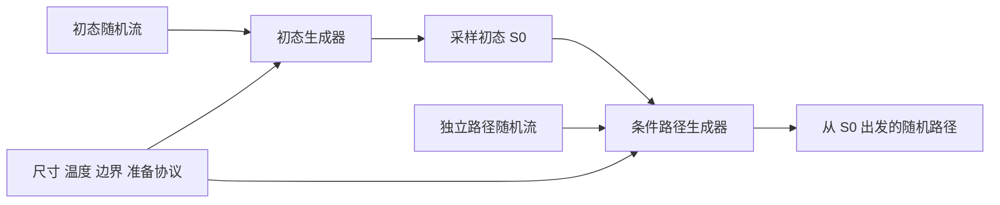

# 两阶段随机路径生成与下一步执行计划

> **2026-09-20状态：历史备选，当前不执行初态学习部分。** 用户确认当前无初态网络实际需求，以[初态学习暂缓合同](GENERATIVE_DYNAMICS_SCOPE.md#initial-state-deferred-20260920)为准。下面“纳入目标架构”“同步专用初态库”“初态网络训练”“四组闭环前置”等为2026-09-19旧决策，不再约束当前执行。原文保留追溯，不触发删除旧产物、取消任务或新增训练；初态准备协议、独立随机流和条件路径验证仍有效。

_2026-09-19 · 修订12 · 架构决策已接受；初态生成器尚未实现或训练。_

---

## 🎯 决策与范围

同一哈密顿量体系的小尺寸数据分别用于学习指定准备协议的初态分布与条件路径，在更大尺寸检验组合后的动力学统计。常规输入为尺寸、温度、逐轴边界、seed和时长；体系、晶轴与初态准备协议绑定模型包。指定初态入口保留用于诊断。

本修订覆盖旧方案中“初态模块仅可选”和“最后才考虑初态数据”的表述：初态模块纳入目标架构，数据合同现在准备，训练与联合认证分阶段完成。不修改冻结checkpoint，不取消路径模型的首帧硬约束，不宣称端到端生成已经完成。

## 🔧 两阶段架构

令条件为 $c$，准备协议为 $a$，目标分解为：

$$
p(\mathbf S_{0:H}\mid c,a)=p_\phi(\mathbf S_0\mid c,a)\,p_\psi(\mathbf S_{(0,H]}\mid\mathbf S_0,c).
$$

上式简化条件形式假定完整磁构型及给定驱动足以描述当前随机LLG状态。若引入有色噪声或额外慢变量，需要扩充状态。

纯文本摘要：噪声先生成初态，再由独立噪声生成未来。首帧只在本次条件采样中固定，不是所有样本共用一个初态。大尺寸首帧由初态模型直接输出；大尺寸LLG用于独立检验，不是最终每次生成的前置步骤。

初态模型候选为无时间轴的球面流匹配，复用可变尺寸、边界感知的空间多尺度模块，不输入真实初态锚点。归一化独立随机向量只作为latent或明确的无序淬火协议，不能代替训练好的有限温初态生成器。先实现一维开放链，二维、三维及周期边界分别验证。

路径模型保留现有条件入口，首帧设为给定或生成的S0。用户seed派生独立初态流与路径流，保存模型版本、协议ID和派生seed；改变路径seed不改变初态。接续下一块使用上一块末态或经验证的历史上下文，不能每块重抽初态；可接续不等于无限时间无偏。

同时生成首帧和未来也是可行备选，但仍须学习初态分布。当前采用两阶段以便分别定位初态、动力学和支持域失配，并非断言整段方案不可行。

## 💾 初态数据合同

现有六类父状态等额采样及最远点筛选服务于条件动力学覆盖，不能当作自然占据概率。216个父状态的多噪声后继也不能重复计作数千个独立初态。

| 数据 | 用途 | 权重解释 |
| --- | --- | --- |
| 六族覆盖库 | 条件动力学训练 | 人工覆盖权重 |
| 协议初态库 | 初态生成训练 | 指定制备分布 |
| 独立初态检验库 | 初态分布检验 | 同协议独立制备 |
| 大尺寸参考库 | 尺寸迁移评价 | 不回流该主张选模 |

先审计来源、制备时长、母轨迹与采样权重。首轮建议选择明确的非平衡准备协议，例如固定饱和方向、规定扰动分布与准备时长；具体参数须冻结在配置中，不在此擅自指定。无需强制平衡态；只有声称平衡初态时才需相应认证。若混合准备族，必须披露混合权重。

按独立制备运行或母轨迹划分训练、开发、测试；相关帧不算独立样本。样本量依据参考误差、有效独立样本量和覆盖缺口决定。初态与动力学支持域须相容；生成初态落入未覆盖区域时，应补充无偏后继标注，而非直接发布组合模型。

## 📊 当前状态与四组验收

依据[闭环报告](../tests/bauer_closed_loop_20260919/assets/report.json)、[数据审计](../tests/bauer_closed_loop_20260919/audit.json)与[网页](../tests/index.html)：Bauer L16/25/32已有基础2304条、开发细步长576条100 ps路径；A/B/C/D三seed共12次先导已完成，当前模型输出窗1 ps、11帧，路径统计尚未全面通过。初态模型尚未实现训练；二维Miltat单条1 ns仅为参考演示。该状态不是本轮重跑结果。

| 组合 | 初态 | 未来 | 作用 |
| --- | --- | --- | --- |
| R/R | 目标协议真实初态 | LLG | 整体参考 |
| R/G | 同批真实初态 | 路径模型 | 隔离动力学误差 |
| G/R | 生成初态 | 从该初态重启LLG | 初态误差传播 |
| G/G | 与G/R相同生成初态 | 路径模型 | 组合模型检验 |

R/G对R/R、G/G对G/R用相同父构型和独立未来噪声比较，不要求逐路径配对。G/R对R/R检查初态影响，G/G对R/R检查整体结果。G/R参考计算属于开发验证成本，不是发布后采样的必要步骤。

初态指标：磁化/能量分布、局部夹角、空间相关及结构因子、畴结构与边缘统计。路径指标：条件增量均值/协方差、多滞后时间关联、空间相关、联合路径距离及事件概率。模长、边界与适用旋转协变属于结构检查，不代替概率认证。阈值在开发阶段预声明，不因测试失败而放宽。

## 📍 下一步执行顺序

1. **参考误差校准优先。** 按尺寸、准备族分析现有开发集的参考—参考、增量及时间关联；不足时定向补分支。8对8的参考误差不能直接作为16对16模型比较的噪声底。
2. **同步准备初态合同。** 审计来源、冻结一个制备协议，建立独立初态manifest与覆盖报告。复用合格数据，缺失再补，不必等动力学全部通过。
3. **修正条件路径。** 分离采样积分、有限分支误差、时间建模和覆盖问题；据开发诊断做最小修改，保留三seed对照，不以综合分数掩盖关键失败。
4. **实现初态最小模型。** 在tests建立球面初态生成器、独立seed管理及组合入口，先测模长、首帧相等、复现性和同初态多样性，再短预算训练和分布验证。无合格初态checkpoint时不能静默回退随机磁矩并声称物理生成。
5. **小体系四组闭环。** 完成R/R、R/G、G/R、G/G并冻结模型；若测试已参与反复调整，另建最终未使用测试集。
6. **尺寸推广优先。** 固定已验证窗口，先L50再L100，分别检查初态与条件动力学迁移。1 ps只是先导窗，依据参考相关时间逐级增加直接训练窗，不立即跳到10 ns。
7. **时间与其他体系。** 独立测试延长窗口和接续；一维闭环后推进二维训练，三维随后。报告文献统计与同精度端到端成本，包含初态、路径生成及数据训练摊销。

本轮只调整方案、计划与网页，未新增训练或Slurm提交。后续GPU用rtx4090，任务名zrs-mag，批量CPU用fat。试验代码、配置、日志和结果先存tests，经验证及用户批准后晋升。

## 🔗 入口

- [上一版合同](MDGEN_MLIP_PATH_PLAN_20260918.md)
- [多尺度架构](MULTISCALE_STOCHASTIC_PATH_ARCHITECTURE.md)
- [现有条件路径实现](../tests/bauer_closed_loop_20260919/model.py)
