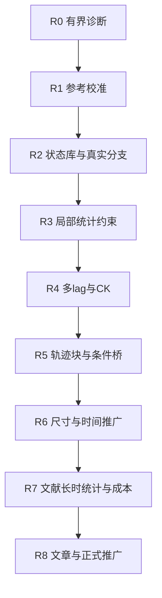

# 多时间尺度随机动力学与小体系数据方案

2026-09-18修订11覆盖：以[MLIP式数据闭环合同](MDGEN_MLIP_PATH_PLAN_20260918.md)为当前实施依据。探索父状态与真实无偏未来分支分开；父来源划分后切窗，基础步长用于学习、细步长仅核验，增强准备族比例不当作自然占据率。已提交先导不改动；候选H为1/10/100 ps，尚未冻结训练窗，不自动启动批量训练。

2026-09-17修订10覆盖：普通条件路径块接续进入当前架构设计，不再只是远期选项；Diffusion Forcing和潜空间仍需诊断后单独决定。固定块长、按需总时长；单块验证后分别做尺寸测试与多块测试，再联合。见[架构第5.6–5.7节](MULTISCALE_STOCHASTIC_PATH_ARCHITECTURE.md)及[工作计划P0–P7](WORK_PLAN.md)。数据需保留真实连续块和独立长窗参考，先隔离父轨迹再切窗，不能以生成后继代替真实监督。本轮只记录计划。

_2026-09-16 · 修订9范围标注 · 保留修订6技术细节，未实现条目不得写成已有结果。_

当前单步与整段受控比较见[修订9计划](PATH_MODEL_AND_PHYSICS_PLAN.md)。本轮优先整段候选并保留单步对照，不预设滚动有原理错误。Diffusion Forcing、块拼接与潜空间仅为后续选项；直接处理磁矩张量，不用RGB渲染或视觉质量代替物理统计。

当前执行顺序见[项目总览](PROJECT_OVERVIEW.md)：优先更长有限时间联合路径与同窗尺寸推广。以下“多lag先于轨迹块”及R0–R8是修订6路线留档，不再是第一阶段的强制先后条件。状态库、可信标签和统计约束继续适用；时间组合、条件桥及长时外推在后续阶段单独验证。669798–669804于2026-09-16查询均已完成；下文提交时状态仅为历史记录。

---

## 🎯 决策与研究边界

本细则属于[主协议](PUBLICATION_GRADE_RESEARCH_PROTOCOL_20260911.md)，排期见[工作计划](WORK_PLAN.md)。当前唯一体系仍为 Bauer 开放铁磁链：利用同体系小尺寸数据学习条件随机演化，冻结模型后检验大尺寸、长时间的路径统计与文献结论。小体系不必呈现大体系相同寿命；训练初态也不必来自全局平衡。

方法发展方向为：可信条件后继 → 丰富局部环境 → 多时间间隔转移 → 必要的联合轨迹块／条件桥 → 物理统计和时间组合校准 → 独立尺寸／时间验证。漂移与扩散学习作为可解释对照；解析力辅助作为单独消融，不默认输入主模型。

这不是宣称时间滚动原理错误。完整自旋状态、白噪声热浴及完整条件下可以组合马尔可夫转移；局部裁剪、总磁化等未闭合投影不能直接继承这一假设。有记忆热浴或隐藏变量需扩充状态，非自治驱动需携带绝对时间／协议。

贡献仍待证明：小数据学习随机演化、受控空间／时间推广、生成路径的机制与概率权重、精度匹配成本收益。球面投影或网络类型本身不作为独占创新；单步预测、均值预测、短窗分布和长时事件分别评价。

## 🔍 当前证据与竞争解释

以下来自[既有论文图包](../tests/paper_work/README.md)，不是本轮重算或实时队列状态。

| 已知事实 | 解释边界 |
| --- | --- |
| 1536条L25训练轨迹，每条0.08，提取12288个0.01转移对 | 窗口不是独立轨迹；没有直接监督文献长时路径 |
| 部分0.01/0.08统计接近参考间差异 | 有限短时一致性，不是高精度全分布认证 |
| L25时间8已有偏差，seed33空间结构明显退化 | 时间累积及训练稳定性需诊断，不能只归因于尺寸 |
| 简单随机基线部分指标相当或更好 | 复杂模型优势尚未建立 |
| 局部描述符显示训练与后续状态有距离 | 覆盖风险提示，不是未覆盖体积或因果证明 |
| 原有限窗口缺有效反向首达事件 | 真实和生成同时零事件不证明概率正确 |

参考数值误差、抽样精度、覆盖、优化／选模、容量／空间上下文、采样积分与多步累积分别排查。不得预设仅需更多训练；增加生成数也不能消除模型偏差。

## 🔄 时间推广方案与注意事项

| 方案 | 学习对象 | 收益及限制 |
| --- | --- | --- |
| 漂移／扩散 | 条件平均变化和随机协方差 | 可解释，但仍需积分，加速不自动成立 |
| 多lag转移 | `P(S(t+Delta) | S(t), Delta, c)` | 可减少调用；端点正确不保证中间路径 |
| 联合轨迹块 | 多个物理时刻的条件联合分布 | 更贴近路径目标；需查块边界和累计误差 |

修订6曾计划先多lag再比较轨迹块；当前改为共同数据的单步／整段对照，多lag和条件桥留作后续选项，不一次实现全部架构。相关多时间分辨率转移与样本驱动生成元方法仅提供借鉴，不替本项目认证[^1][^2]。

### 三类时间严格分开

- `dt_ref`：真实LLG内部积分步长。
- `Delta / save_dt / T`：物理转移跨度、保存间隔和总观测时间。
- `tau / flow_steps`：生成模型内部运输时间和积分步数。

运输中间构型不是物理中间帧。增大Delta与减少flow_steps分别验证；只训练0.01的模型不能改输入就声称学会更大跨度。多lag需来自真实物理标签，可先对Delta、2Delta、4Delta设计有界先导，但具体数值和资源须另冻结，不构成已批准的批量矩阵。

### 时间组合、轨迹块与条件桥

完整状态及适用自治条件下，检验：

```math
P_{\Delta_1+\Delta_2}(y\mid x,c)
=\int P_{\Delta_2}(y\mid z,c)P_{\Delta_1}(z\mid x,c)\,dz.
```

固定开发初态、lag组合、分支数、距离和不确定度，比较直接生成、分段生成与真实LLG三者，覆盖端点及多时刻联合统计。两个错误核也可能自洽，CK不能替代真实标签。

轨迹块硬锚定输入初态，监督全部自由物理帧；连续块传递实际末态及必要条件，检查块内／跨块增量、关联和事件时间。末帧接上不等于概率正确。若先生成粗端点再补中间路径，需校准目标动力学的条件桥 `P(interior | endpoints,c)`，端点也须来自正确转移；不得挑选理想终态、使用任意桥或球面插值冒充真实路径。

粗保存可能遗漏多次翻转，首达／驻留单独检查时间分辨率。有限窗训练不保证任意长时，报告 `T_valid(condition,observable,tolerance)` 和未测区间。更大Delta同步检查空间上下文、halo及状态闭合：瞬时相互作用局部，不代表长跨度核只依赖原小邻域。

## 💾 丰富局部状态库与无偏后继

### 三类互补来源

| 来源 | 内容 | 限制 |
| --- | --- | --- |
| 目标条件真实LLG探索 | 自然涨落、倾斜、壁移动中的构型 | 短运行不保证包含稀有结构 |
| 人工构造并扰动 | 正反磁盆、不同壁位置／宽度、边界核、不同波长自旋起伏 | 不是自然占据频率样本 |
| 模型暴露薄弱状态 | 训练距离大、模型分歧大或真实对照误差大的构型 | 分歧只是线索，模型一致也可能共同出错 |

不主要依靠完全随机自旋，它可能集中于无关高能环境。区分链端／内部、均匀倾斜／强梯度、壁形成／移动／消失；相同总磁化可以对应不同空间结构。人工patch必须保留合法邻域及halo，不把所有局部裁剪误作开边界小链，完整L25也不自动覆盖长链的全部上下文。

每个选定完整初态固定Hamiltonian、温度、阻尼和边界，用独立未来噪声产生真实短分支，并保留多个lag和必要物理帧。不同初态提供环境覆盖，同初态多噪声提供条件概率精度，两者不能互相替代。

### 人工丰富初态不等于修改自然后继概率

可以提高稀有初态在训练库中的比例，但固定初态的后继必须完整保留，不筛“成功翻转”以人为制造多峰。条件核训练不要求初态池服从平衡分布；记录采样规则、概率／层级权重，分别报告逐状态和目标初态分布加权结果。有限容量下重采样改变误差分配，需要对照。

若高温、偏置等辅助过程只用于发现候选构型，记录其来源，并重新在目标条件下产生无偏后继；辅助轨迹及其时钟不得直接混作目标标签。模型提出的状态不是监督真值，也不能靠生成结果自行认证磁盆。真实后继中的未翻转、返回、成功、未决及数值失败分别留档。

### 覆盖检查与主动补样闭环

1. 固定局部描述符：相对易轴分量、邻键点积、局部扭转／梯度、边界位置、适用能量和多尺度邻域；记录训练拟合的归一化、距离、池大小及提示阈值。
2. 同时检查总体投影及状态分组。低维重合、总磁化遍历或单一近邻比例不构成充分覆盖证书。
3. 在独立真实开发状态上，绘制条件误差对描述符距离、位置、温度和结构类型的关系，附参考自身不确定度。
4. 定向候选与固定探索样本混合保留，不仅选择模型分歧大的点；低分歧但真实误差大的环境同样补标签。
5. 新标签按来源族隔离，固定对照预算，比较补样前后误差与支持范围；生成输出不得当真值回灌。
6. 根据分组误差、参考精度、覆盖趋势和新增标签边际收益决定继续或停止，不以一个覆盖数字宣称已“学到所有机制”。

补样轮数、每轮上限、停止规则、目标误差和区间精度在执行前冻结。没有无条件足够的样本数；分支数需根据精度、事件率和成本先导确定，时间帧／邻域／相关窗口不能当独立重复。用目标尺寸测试数据反馈补训后，该域改称适配／开发，不能继续宣称零样本推广。

## ⚙️ 物理约束与训练目标

### 三层约束及可选解析辅助

| 层级 | 约束与来源 | 不能据此声称 |
| --- | --- | --- |
| 几何／结构 | 单位球面、初态硬锚定、开边界及适用协变性 | 轨迹合法就代表概率正确 |
| 局部条件变化 | 真实分支的增量均值、协方差、跨格点相关和分布距离 | 少数矩相等唯一确定完整转移分布 |
| 多时刻／机制 | 真实路径的能量增量分布、空间关联、时间联合统计、CK、壁运动 | 短时自洽保证文献寿命 |
| 可选解析辅助 | 明确披露的有效场、生成元或涨落—耗散约束 | 使用解析动力学信息后仍称纯样本方法 |

联合旋转自旋、初态、易轴、场及张量后检查协变；固定易轴下不能强制任意自旋旋转不改变物理。链反射只用于有该对称性的体系，加入DMI等后重推。温度／阻尼／驱动若跨条件变化，必须有可识别输入或绑定途径。

### 条件增量与弱动力学统计

令 `v_i=Log_{x_i}(S_i(t+Delta))`，固定完整状态和条件，匹配 `E[v_i]`、`Cov(v_i,v_j)`及必要的高阶／分布统计。均值和协方差可由真实分支估计，不要求解析有效场输入网络。极短间隔下均值可能被噪声掩盖，需报告样本精度及多个Delta对照。

当前Bauer约定下，充分短时间的领先阶协方差为[^3]：

```math
\operatorname{Cov}(\delta S_i\mid x)
=2\lambda\vartheta\Delta(I-x_ix_i^\top)+o(\Delta).
```

这不是所有LLG约定的通用公式。有限Delta中相互作用会形成跨位点相关，不能强制后继独立。有限步球面Log矩不是精确无穷小漂移／扩散；若用生成元，明确Itô／Stratonovich转换与球面几何项。

可加入可观测量的条件变化：

```math
D_\Delta f(x)=\frac{E[f(S(t+\Delta))\mid x]-f(x)}{\Delta},
\qquad f\in\{h/N,M_z,\text{bond correlations},\ldots\}.
```

样本估计版本与解析生成元版本分别命名。有限温不要求每步能量下降或严格能量守恒，不对未观测热增量施加确定性LLG残差。能量分布正确也不保证反转时钟正确；平衡MCMC校正不直接赋予链步真实物理时间。

### 损失消融与选模

候选结构为 `L_FM + w_inc L_increment + w_obs L_observable + w_CK L_CK + w_block L_block`，仅作模块登记，不默认全部启用。硬约束不重复堆无用软惩罚。每项写清重复单位、归一化、参考精度、样本来源、权重、作用lag和失效条件，并测试估计器偏差。

先固定数据比较局部统计辅助，再固定约束比较覆盖增强，之后比较多lag、CK和轨迹块；保留共同基线，分辨数据和目标改变的影响。至少三个训练种子、同骨干确定性与简单随机基线并报；相同更新数不等于相同FLOPs／时间。

选模检查局部条件分布、多步误差、空间结构、时间组合、事件可辨识度及成本；主指标、否决项和权重预先登记，不能事后拼有利总分。现有补全任务按0.08终态energy distance选择checkpoint，只是冻结的探索性规则，尚未实现本细则的多指标路径验收；不在运行中修改旧合同。

## 🔬 可信条件标签的处理顺序

| 顺序 | 工作 | 交付与判据 |
| --- | --- | --- |
| 1 | 冻结物理／数值合同 | 约化映射、方程、噪声、边界、时间、代码／配置哈希一致 |
| 2 | 固定初态真实独立分支 | 起点来源、噪声标识及所有结果可追溯 |
| 3 | 固定物理观察间隔，减小内部步长 | 条件均值／协方差、能量／空间统计及适用事件收敛，不只看范数 |
| 4 | 分离抽样与数值误差 | 同方法等量独立R1/R2与方法／步长对照分开报告 |
| 5 | 先分来源族，再切窗／提多lag | 同初态分支、父轨迹窗口、相关来源族不跨split |
| 6 | 条件参考图表及误差范围 | 增量方向、协方差谱、跨位点相关、区间和分组误差可复算 |

不同随机积分器不要求逐条轨迹相等。Wiener方法强比较采用合法嵌套增量；MT弱离散噪声不能冒充相同Wiener路径。数值失败不当作物理右删失，不静默删掉失败后仅分析剩余结果。

人工非平衡初态可以不典型，但其无偏条件后继仍可可信。独立Monte Carlo仅用于明确平衡主张或独立求解器诊断，不是全部非平衡标签的普遍门槛。平衡初态若实际使用，则仍履行其自身的准备／混合诊断。

## 📋 实施顺序与放行条件

| 阶段 | 工作 | 放行／退回条件 |
| --- | --- | --- |
| R0 | 收齐既有有界诊断 | 完整性、参考精度及误差类型明确，不重写历史实验 |
| R1 | 可信标签合同与参考校准 | 使用范围内数值／统计精度可解释；否则先修参考 |
| R2 | 局部状态库、分支、覆盖审计 | 来源隔离、重点环境有标签，补样上限冻结 |
| R3 | 局部约束与覆盖受控对照 | 固定数据／预算可复算，改善不只体现在训练loss |
| R4 | 多lag与真实约束的CK | 直接／组合／真实三方验证，空间上下文同步核查 |
| R5 | 联合轨迹块／必要条件桥 | 中间物理帧、跨块统计和事件分辨率可信 |
| R6 | 分开尺寸、时间及联合推广 | 冻结模型与留出域，逐组报告有效范围和失败 |
| R7 | 文献条件长时生成与成本 | 磁盆、事件、精度及资源合同齐全，寿命按原文定义 |
| R8 | 文章整理与正式代码推广 | 用户确认后合入生产，保留失败、三seed及基线 |



R0–R2细分P1/P2，R3–R5细分P3，R6/R7的确认性执行仍先经过P4冻结并在P5检验，R8对接P8。有限探索可并行，不要求所有误差为零才诊断其他维度；查看后用于调参的数据不能改名盲测。

文章按“问题与数据域—可信标签／覆盖—方法—小体系条件路径／基线—尺寸／时间推广—机制与文献寿命／标度—精度匹配成本／局限”组织。六图框架仍由[核心主线](CORE_RESEARCH_MAINLINE.md)管理，本细则增加对应证据，不开启无关材料分支。

事件分别记录 `negative_endpoint / crossed_zero / committed_switch / crossing_return / unresolved_transition`，写清初盆、零点、核心、进入或驻留确认时刻及尾窗。开发的 `reverse_core_residence` 不自动等于完成翻转；畴壁初态和初始就在核心的情形单报。磁盆按尺寸／温度校准，不直接套L25阈值。保留未决与有限窗口界，不用成功分支归一化冒充committor；延长观测另审预算，不硬设阈值。

## ⚠️ 实施状态、资源与禁止事项

[已提交的有界补全](../tests/paper_work/completion/README.md)仍是单lag模型、数据量／确定性基线对照、L25/50/100、时长32及部分200和同GPU计时。669798–669804来自[本地提交记录](../tests/paper_work/completion/submission.json)，不是本次查询的运行状态。它没有实现本细则的新状态库、主动补样、多lag、CK训练或轨迹块。

待用户通知完成后按R0分析，再为后续阶段落实配置和资源合同。开发代码／配置／数据／日志／结果仍在tests，经验证及用户同意后推广生产。GPU用Slurm rtx4090、GPU分配及 `--device cuda`，大批量CPU用fat，任务名zrs-mag，使用指定Conda环境。无人为最多两个并发限制；提交后不持续监控，失败依赖不无限重试。静态图仅PNG，保留源表、配置、哈希和网页。

当前0.01步长到750000需7500万次物理转移，不无预算直接启动。长时分块续跑脚本不等于长时结果。粗步收益计入中间轨迹恢复、I/O、数据、训练、调参与验证；同GPU不同精度只算吞吐对照，不直接宣称同精度加速。少量真实LLG校正也不保证消除已有偏差，混合方法单独命名、验收和计费。

## 🔗 来源与状态

本文件采用Markdown决策记录结构分开方案、限制与实施状态；外部方法不被当成本项目成功保证。本轮只更新GUIDE，不改冻结代码／任务，不提交新计算或Git推送。

[^1]: Schreiner, Winther and Olsson. *Implicit Transfer Operator Learning: Multiple Time-Resolution Surrogates for Molecular Dynamics*. 已核对原始方法摘要，具体移植待核查。https://arxiv.org/abs/2305.18046
[^2]: Klus et al. *Data-driven approximation of the Koopman generator: Model reduction, system identification, and control*. 原始方法摘要支持样本识别漂移／扩散，不保证大步或稀有事件加速。https://arxiv.org/abs/1909.10638
[^3]: Bauer et al. *Thermally activated magnetization reversal in monoatomic magnetic chains on surfaces studied by classical atomistic spin-dynamics simulations*. Eq.(2)及噪声约定；短时协方差由其约化旋转噪声项推出，有限步适用性待验证。https://arxiv.org/html/1010.4730v2
