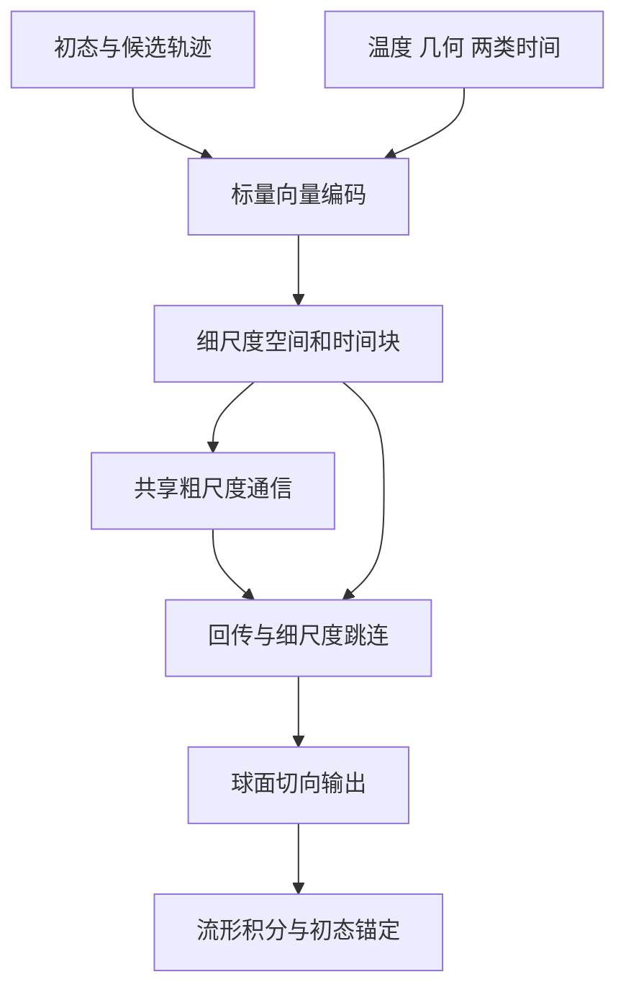

# 可迁移多尺度随机路径模型：架构设计与选择依据

## 🎯 2026-09-23用户确认：Bauer一维开放链首轮最小闭环

当前先在Bauer一维开放链形成完整、可检查和可归因的证据链，不同时铺开全部体系、温度、尺寸和时长。该实施顺序不收窄最终多体系方法和大体系生成目标，也不宣布历史Bauer实验已满足本轮新合同。

1. 审计并优先复用已有数据：核验实际Hamiltonian与能量函数、初态来源与分支噪声、来源分组划分、物理时间网格及参考数值精度。仅针对查明的缺口补充数据，不因更换骨干自动重建全部数据。
2. 根据已有数据中可测量演化、统计支持和计算预检选择有限物理时间窗。不能把窗口压短到几乎无变化来获得表面一致，也不把完整长时文献结果作为首轮门槛。具体时长、轨迹数、预算和容差尚未由本次确认冻结。
3. 固定物理体系、温度、开放边界和时间设置，建立局域等变条件路径基线。多尺度／能量辅助随后逐项受控引入，不在首轮同时改变所有设计。固定温度实验不能证明温度依赖。
4. 在独立开发父状态上采样多个未来，展示完整磁矩时空图、能量分布及时间变化、条件增量均值／协方差、时间与空间关联、误差区间和成本。重复训练及数据来源合同继续适用；暂不以未经用户确认的事件规则作硬门槛。
5. 交付明确适用域、分项达标／偏差／证据不足、可能误差来源及下一项有依据的改动。任务退出正常、loss下降、合法模长或动画相似不构成闭环成功。
6. 满足预先确认要求后冻结模型开展同窗尺寸迁移；未满足则针对数据、采样或模型诊断，不默认加预算、延长训练或扩大任务矩阵。探索性推广可单独开展，但不能替代受控证据。

全部新增实验代码、配置、日志、数据和结果保存在tests，正式晋升仍需验证和用户批准。首轮结果接入可检查的网页时，区分参考、生成、软件检查和科学评估；只展示实际存在的数据，不用占位结果冒充完成。本次仅记录计划，不审计或生成新数据、不修改代码、不重训、不提交任务。

## 🎯 2026-09-22用户确认：核心方法贡献的对照证据

待验证主张为：用小体系条件随机路径学习局域演化，通过多尺度时空生成，在更大体系恢复主要动力学统计并降低重复采样成本。该表述是研究目标，不是已有结果；不能仅以组合图网络、注意力和流匹配宣称创新或有效。

| 对照 | 隔离的设计问题 | 主要证据 |
| --- | --- | --- |
| 局域等变图／多尺度等变图 | 更宽空间信息通路是否有用 | 小体系统计及未调参大体系的远距离相关、低波数涨落 |
| 单步接续／多帧联合路径 | 时间组织是否改善 | 同物理任务的时间关联、累计偏差及同精度成本 |
| 仅流匹配／能量统计辅助 | Hamiltonian辅助是否改善动力学 | 能量与未直接优化的增量协方差、时空相关、多样性及尺寸迁移 |

对照保留相同来源划分和物理条件，预先声明预算口径、帧网格、总物理时长、选模规则与重复训练seed。记录参数量、训练和采样计算量；相同更新次数不自动等于相同成本。单步与联合路径比较允许各自原生块组织不同，但最终评价任务与输出网格须可比。

不自动启动完整组合矩阵。按局域基线、空间多尺度改动、时间组织、能量辅助逐项推进，保持其他主要因素不变；顺序比较只能支持相应背景配置下的增量作用，发现关键交互时另补有针对性的组合对照，不能以一次单因素结果证明所有模块独立贡献。

各组均报告不确定性、负结果和副作用。多尺度没有改善不得称其有效；联合生成不预设优于单步；能量拟合改善但其他统计恶化时报告权衡，不称全面提升。软件合法性仍单独核查。方法贡献落到可测量问题的解决，文献新颖性待最终方法明确后作针对性已有工作核查，当前不声称首创或保证期刊级创新。

本次仅记录已确认对照路线，具体数据量、超参数、预算和任务提交尚未冻结。无新增训练或对照结果，不改动旧实验。

## 🎯 2026-09-22用户确认：同精度效率与前期成本回收

效率目标是在指定物理任务和统计容差内降低计算成本，而不是只快速输出数据。比较保持体系尺寸、Hamiltonian协议、温度、边界、初态准备、物理时长及输出网格一致；预先声明目标观测量、误差与不确定性标准。未满足精度的生成不能作为该精度下的加速证据。

- LLG使用经过数值收敛核验的适当积分配置，模型使用经过验证的flow步数及接续设置；不得故意过度细化参考步长、缩短生成物理时长或改变保存分辨率制造优势。
- 分别报告单条端到端延迟、固定资源下批量吞吐、以及前期数据生成／训练／验证加后续采样的总成本。LLG同样允许批处理和并行，不能将GPU批量模型对CPU串行参考的全部收益归因于模型方法。
- 区分同硬件算法比较和实际部署工作流比较。登记CPU／GPU型号、数量、线程、batch、精度、软件配置、内存峰值及轨迹长度；排队时间单列，不混作计算时间。
- 分别记录冷启动／加载／编译、预热后计算、初态准备、数据传输及写盘，端到端统计说明纳入哪些部分。GPU计时正确同步，重复测量并报告波动，不以一次最短耗时代表稳定表现。
- 使用相同成本单位计算收支：若前期成本为C_setup，LLG和模型平均每条成本为c_LLG与c_gen，在成本近似稳定且c_LLG大于c_gen时，回收点为M大于C_setup除以(c_LLG-c_gen)。batch、规模或硬件不同导致非线性时使用实际总成本曲线，不套固定单条成本公式；异构硬件时长不能不作说明直接相加比较。
- 前期成本范围明确登记，区分单个固定方案的摊销与研究开发／多seed／失败试验总支出；不得隐去数据和必要验证成本。复用数据可分别报告从零构建与已有资产下的边际场景。
- 最终同时展示固定轨迹量的成本与达到相同统计误差的成本。独立样本误差、参考数值误差和模型系统偏差分开；增加生成量不能越过偏差下限。不满足容差时报告该目标下尚无有效加速，而非只给吞吐数字。
- 在已验证范围内报告尺寸、条件、时间窗、单条加速、批量收益和回收点，不声称所有体系或任意时长均加速。

本次仅确认效率目标和后续测试约定，不启动测速、参考模拟或训练。历史冒烟耗时仅证明对应代码可执行，不自动升级为同精度加速结果。后续提交前仍须估时，超过10分钟的任务提交确认后不持续监督。

## 🎯 2026-09-21用户确认：尺寸、时间及联合推广分开验证

尺寸迁移目标是模型生成的大体系与同条件真实大体系统计一致，不是要求大体系统计等于小体系。允许真实有限尺寸差异；网络可接收更多节点或生成一条长轨迹，不构成物理迁移证据。

- 首先冻结模型与选定采样配置，在同Hamiltonian体系、同边界协议、同温度、同物理观测窗和输出间隔下只扩大尺寸。初态按同一物理准备规则在目标尺寸构造，不要求复制小体系初态；核查大体系局域环境覆盖。
- 目标大尺寸保留独立LLG参考，不需默认建设与训练库等量的大数据集。先做有代表性的同初态独立未来比较，参考数量按主要指标不确定性与覆盖需要决定；少量演示不足时明确标记探索性。
- 同窗迁移主要比较条件增量均值／协方差、能量与磁化统计、距离分辨空间相关、低波数涨落和时间关联。全部比较使用该尺寸正确的物理几何与能量，不能机械沿用小体系数值作为目标。
- 另在已验证尺寸上延长物理时间，检查块间接缝、跨块相关和累积误差；最后在大体系上延长时间，独立报告联合推广结果。三阶段是证据分解，不要求上一阶段零误差才允许有边界的探索，但未经验证的结果不得写成成功认证。
- 目标尺寸数据不用于该次冻结迁移主张的训练或调参。若看到偏差后据此改模型，该数据成为开发参考；新的最终迁移证据需保留相应独立检验，并如实声明已使用哪些目标尺寸信息。
- 文献条件与结论作为最终外部检验，与小体系条件演化及独立大体系对照共同形成证据。对上少数文献图或观测量不证明整个路径分布正确；不将文献未给出的随机初态／噪声要求逐条复刻。
- 经过验证的模型可在已声明范围内生成更多轨迹，不要求每条模型路径都配一条新LLG路径；条件、时间或尺寸超出已验证范围则另行评估。更多模型样本不能弥补模型偏差或独立参考缺失。

本次仅确认验证路线，未冻结新的尺寸矩阵、轨迹数、阈值或预算，未启动参考生成、训练或评估，也不声明现有模型已通过以上阶段。

## 🎯 2026-09-21用户确认：统计不确定性与分项选模证据

不确定性主要描述有限轨迹导致的统计估计波动，不是网络自行输出的置信度。真实分支间涨落与估计精度分开：固定父状态下，能量分支标准差描述热涨落，均值标准误在分支独立时为标准差除以分支数平方根。更多独立分支提高估计精度，不会消除真实热涨落。

- 对固定模型、固定父状态且两组未来独立的能量均值差，标准误平方为模型分支样本方差除以模型分支数，加参考分支样本方差除以参考分支数。均值的t区间需要相应分布／样本量假设；不能用该公式覆盖任意分布距离或相关估计。
- Bootstrap按实际独立采样单位设计。固定父状态下重采样整条独立分支，保留内部时空结构；不能把格点、相邻帧或重叠窗口当成独立重复。
- 先声明估计目标：只描述这些固定父状态，或推广到一个准备来源总体。前者主要估计各父状态内分支误差；后者考虑独立来源组／父状态差异，保留模型和参考的父状态配对及预先声明的分层权重。多层重采样方式须匹配采样设计，不能机械叠加各层误差或重复计入变异。
- 方差、相关、分布差异等可采用适用的重采样区间，但须检查小样本、估计偏差和退化分布等限制。重复重采样不产生新物理信息，也不能恢复未出现的稀有事件。登记重采样单位、重复数、seed、区间方法和有效独立样本数；重复数在实现时确定。
- 模型和参考样本误差同时考虑；更多模型样本不能消除参考数量不足。参考—参考差异是有限样本基准，不是自动验收阈值。
- 训练seed间差异、LLG步长收敛、flow步数收敛分别报告；它们不自动包含在固定checkpoint的抽样置信区间内。覆盖缺口和系统偏差另行核查，窄区间可能围绕错误答案。
- 绘图分别展示均值及置信带、分支分布／分位带、模型—参考差及置信带／容差带，明确单位、样本数和区间含义。逐点95%区间不是整条曲线95%同时覆盖；整窗结论需同时置信带或预先定义的整窗指标，并处理多个比较。
- 区间含零不证明等价；只有在适当统计设计下相对预先确认的物理容差判定，才能支持有限精度结论。容差不能看完结果再调整，样本不足时保留不确定／证据不足。

选模使用来源独立的开发集，结构合法性与分项物理统计并列，不以最低训练loss、单一能量指标或任意综合分数替代判断。能量进入训练后，还需检查未优化的时空指标。候选间权衡和不确定性公开，无合格候选时不把相对最好称为通过。最终测试在模型与设置冻结后使用；反复用于调整的数据只能作为开发证据。

本次仅确认估计与报告要求，尚未重算现有区间或证明旧区间均适用。后续先审计评估器的独立单位、分层权重和已使用测试数据，再实现／验证必要修改；不改写冻结结果、不提交新任务。

## 🎯 2026-09-21用户确认：能量统计辅助训练与事件判据确认

能量采用与数据生成实际物理协议一致的Hamiltonian计算，作为重要连续观测量，并开展能量统计辅助损失的受控验证。当前先统一能量定义，不直接将旧评估函数接入训练。事件分析保留物理人工判断：未经用户确认的分类规则只能作探索性诊断，不能自动决定模型物理验收。

### 统一能量定义是前置任务

既有代码核查发现：`tests/literature_path_campaign_20260920/evaluate.py`的二维评估调用`cell.energy()/N`，其Miltat模型含交换、各向异性、DMI和完整开放偶极项；`tests/bauer_closed_loop_20260919/metrics.py`的一维旧指标使用硬编码交换项及0.1的z向各向异性，不能未经核对就代表所有Bauer数据的完整能量。此处是实现核查，不表示已经审计所有历史结果或确认全部数据参数。

- 后续对照数据manifest和实际生成配置核验Hamiltonian各项、系数、单位、零点、边界、周期像和键计数；参考与生成样本使用同一权威能量函数。
- 分开报告总能量、每自旋／约化能量及其转换。跨尺寸比较不能忽略归一化、有限尺寸和边界差异。
- 先做小构型各项能量与独立计算核对、梯度／有限差分检查及边界计数测试，再作为可微训练辅助项。保留历史结果，版本化新增或重算的指标，不静默覆盖旧报告。
- 统计术语energy distance不是Hamiltonian能量差，图表与指标名称必须区别。

### 辅助损失比较集合，不要求能量守恒

主目标保留球面流匹配，候选总损失为`L_FM + lambda_E * L_energy`。同父状态、同条件及同物理网格比较生成与参考的能量集合统计，可从均值／方差开始，再按证据增加分布差异、时间联合统计或分项能量。具体形式、权重和预算在实现预检后冻结，不把本节理解为已确定全部损失细节。

- 不要求有限温随机LLG能量恒定，也不要求任意两条独立随机未来逐帧能量相等。
- 辅助项作用于生成物理路径样本或明确论证的目标估计，不强迫每个中间flow草稿已经具有真实能量分布。登记可微采样／反传方式和新增计算成本。
- 有限分支统计噪声、不同能量项抵消及不同构型同能量的退化均须考虑；匹配能量不能替代条件增量、空间和时间关联。
- 网络推理仍无需输入Hamiltonian公式或解析有效场，但训练已显式使用Hamiltonian知识，必须称为物理辅助训练，而非完全不使用Hamiltonian的纯数据方法。
- 保留仅流匹配与流匹配加能量辅助的受控对照，使用相同划分和声明的预算，在独立开发指标上检查收益与副作用；不只用被优化的能量指标选优。

### 人工确认事件定义，再固定并自动统计

先展示磁矩时空图、能量、磁化和空间结构等原始证据，由用户确认成核、翻转、返回、畴壁过程等目标现象和操作定义；确认后保存判据版本并自动应用于完整样本。人工参与不意味着逐条任意改标签，也不能按模型结果好坏事后调整定义。

对阈值、持续时间和空间识别规则开展合理范围的敏感性分析，保留误识别、未决和删失样本及人工修改记录。事件数不足时标记证据不足；既有事件标签保持历史诊断身份，未经确认不作为硬性通过／失败门槛。当前优先采用定义明确的连续物理量评估，事件作为辅助机制解释，确认后才作正式统计。

本次仅更新目标和开发约束：尚未统一能量实现、添加损失、修改事件判据、重算历史结果或提交训练。

## 🎯 2026-09-21用户确认：初态、等变性与空间边界不是三项损失

结构硬约束主要由网络、几何和采样实现满足，不默认增加三个惩罚项。它们分别限定条件分布的起点、坐标变换规律和空间物理协议；仍须独立软件核验，不等于动力学统计自动正确。

### 本次首帧，而非全体轨迹共用首帧

当前目标是给定实际初态后的条件未来。每次调用可以使用不同的指定、规则随机或文献准备初态，大体系也按对应协议准备自身初态；只有本次调用的S0在生成过程中保持不变。同初态仍应允许多个随机未来。

实现可只生成未来帧、输出时前置S0，也可在包含首帧的路径张量中持续固定该位置。两者遵守同一合同，不要求为了文档统一而改写已有采样器。若采样改变了S0，目标就不再是原指定初态的条件路径。初态网络继续暂缓，首帧固定不限制未来启用另一项经确认的初态分布学习任务。

### 等变性由正确运算保证并通过测试检查

正常旋转下，磁矩、晶轴及相关几何方向须共同变换。旋转不变量产生标量权重，标量加权向量、向量加法及叉积产生协变输出；时间模块、条件调制和球面更新同样须保持该性质。磁矩单独相对固定易轴旋转改变物理状态，不要求一般情况下仍有旋转对称性。

旋转前后向量场及完整采样误差主要作为结构实现测试，不把等变性简化为训练中可任意违反的软损失；不宣称已保证镜像反射等变。检查完整采样时须共同旋转对应潜变量，不能把相同数值seed当成相同旋转噪声实现。

### 边界指空间协议，而非首末态条件

开放边界不添加周期跨边界连接；周期边界按各方向晶格定义连接周期像，并正确处理位移与键重数。二维／三维逐轴登记。长程相互作用还须登记有限样品／周期像等物理处理，不能用一条首尾连接概括。

网络通过图连接、跨边界位移和有效邻居处理遵守边界，而不是用一个边界损失让模型猜测。边界绑定模型包，训练和大尺寸生成保持同一协议；不开展自由切换边界或跨边界泛化。条件路径的初态／终态约束另行命名，避免混淆。

本次仅确认含义与开发约束，不新加损失、不改代码或采样器、不重训、不修改历史数据或任务。训练损失与统计辅助项的具体选择仍需单独确认及受控验证。

## 🎯 2026-09-21用户确认：父状态覆盖与独立随机后继

数据组织分为父状态和条件随机后继。父状态是完整磁构型，用于提供目标使用范围内不同局域环境；后继是固定该构型与物理条件、仅改变未来热噪声得到的真实LLG路径。训练目标是条件演化，不只是静态构型分布。

- 父状态覆盖按目标体系确定，包括适用的近均匀热扰动、非均匀纹理、畴壁及开放边缘／内部环境。不是每个体系都必须有所有纹理，也不要求父状态已达平衡；参考方程、准备协议和数值可信度仍须核验。
- 记录父状态ID、准备来源／来源族、物理条件、尺寸、边界、构型与来源时间。增强或主动选样可改善覆盖，但人为选样比例不等于自然占据概率，不将其直接用于无条件事件率。
- 同父状态的后继使用相同初态及协议、独立未来噪声，记录分支seed与时间网格。用于自然条件演化标签时不得按后继事件筛选、丢弃未翻转路径或强制终态。初态随机流和未来随机流分离。
- 单条路径也可贡献训练样本，不要求每个父状态都大量重复。多分支特别用于条件均值、协方差和多样性检验；很多分支不能替代父状态覆盖，很多单分支父状态也不能直接提供精确的逐父状态分布估计。
- 优先建设较广父状态训练库，并保留独立多分支父状态用于开发与最终评估。样本量依据状态覆盖与主要指标不确定性逐步确定，不在本次预设大规模数量，不自动生成额外数据。
- 先按父状态及其准备来源族划分train／dev／test，再截窗、降采样或增强。一个父状态的全部后继必须在同一集合；同来源轨迹的相邻／重叠窗口或强相关派生父状态按组处理，不能随机拆分制造独立性。
- 保存split manifest与来源ID，核查父状态／来源族交集及重复构型、窗口来源。测试集不用于模型选择或迭代调参；已经反复检查并用于修改模型的数据属于开发证据，不能重新称为未触碰的最终测试。
- 覆盖和不确定性分别报告，格点／时间帧不自动作为独立重复。父状态覆盖有限时，声明使用边界；不以更多生成样本消除参考覆盖缺口或模型偏差。

这些是后续数据与训练开发合同，不是宣布既有数据已全部满足要求。本次不修改旧split、原始数据或冻结评估，也不提交数据生成任务；后续先审计现有manifest和来源，再决定有针对性的补充。

## 🎯 2026-09-21用户确认：条件注入与采样引导分开

当前主线采用直接条件球面流匹配，以FiLM／标量门控将温度等实际变化的宏观条件注入多个残差块，不默认增加采样强化引导。FiLM是条件进入网络的结构方法；分类器引导（CG）和无分类器引导（CFG）是采样方向控制方法，二者层级不同、可组合，不是三选一。FiLM为当前工程选择，尚未证明优于其他注入方法。[^cond1][^cond2][^cond3]

### 条件与模型包合同

- 用户指定温度、尺寸、所需时长和seed；尺寸构造图，时长组织路径块，seed只控制随机抽样，不作为物理特征。初态按已确认协议提供。
- 晶格、固定边界、晶轴、体系身份及固定参数随模型包登记；不把Hamiltonian公式或解析有效场作为必需网络输入。固定阻尼／驱动不强行扩展成自由条件，只有研究其变化且具备数据覆盖时才增加输入。
- 实际变化的标量条件按训练集统计量标准化，转换随模型包冻结；开发、测试、生成不得重拟合。物理单位换算与数值标准化分开记录，常量条件不能除以零方差，应固定或省略并登记。
- 标量隐藏通道可用缩放与偏移；向量通道使用不破坏SO(3)协变的标量门控或等变构造，不加入无约束固定方向偏置。
- 温度敏感性通过同初态、同一组潜变量、多温度生成与各温度独立LLG参考比较，检查条件增量协方差、涨落与时间关联。输出不同或温度识别准确不等于条件动力学准确；单温度训练不证明温度依赖，范围外条件另行标记和验证。

### 引导对照与限制

- CFG列为后续受控对照，不是本次自动启动的训练任务。须通过明确的条件丢弃训练条件／空条件分支；空条件不能随意用物理零温代替。登记丢弃哪些条件，必要时仅丢弃温度，保留初态、几何、物理时间及边界协议。
- 若用`v_g = v_null + g * (v_cond - v_null)`的组合记号，`g=1`为普通条件向量场，`g>1`为额外强化；此处是候选采样方案，不声称任意球面flow组合都严格产生某个简单重加权分布。不能不经训练就把旧模型的条件置空当成有效CFG分支。
- CG需适用于运输中间状态的条件概率／辅助模型。温度为连续量，不直接照搬离散图像分类器；扩散score引导公式不能未经推导直接添加到球面流速度，需核查运输过程、切空间及等变性。
- 不把引导一概视为错误：正确条件概率与理想score下的条件化有其理论依据；额外强化、估计偏差和向不同生成过程迁移则需要单独验证。原始CG／CFG研究中的质量—多样性取舍不能直接充当磁动力学准确性的证据。[^cond2][^cond3]
- 对照冻结数据划分、支持域和预算，比较不同引导强度的条件增量均值／协方差、涨落分布、时空关联及计算成本，不以视觉效果或条件识别率选优。引导可能放大代表性行为、压低其他合法路径，故不能默认保留自然概率权重。
- 事件引导可用于成核／翻转机制探索，但其条件化或偏置样本频率不是自然事件概率；如需定量使用，必须另有经过验证的采样／权重校正方案。

当前已有FiLM候选与冒烟检查，尚无上述完整条件统计认证；本次仅更新方法合同，不新增CFG／CG实现、训练或任务，不修改历史权重。

[^cond1]: Perez, E., et al. FiLM: Visual Reasoning with a General Conditioning Layer. https://arxiv.org/abs/1709.07871
[^cond2]: Dhariwal, P., and Nichol, A. Diffusion Models Beat GANs on Image Synthesis. https://arxiv.org/abs/2105.05233
[^cond3]: Ho, J., and Salimans, T. Classifier-Free Diffusion Guidance. https://arxiv.org/abs/2207.12598

## 🎯 2026-09-20用户确认：细粗图交互与尺寸迁移

暂定多尺度空间设计为细尺度等变图、区域粗尺度图和双向细粗特征交互，并保留细尺度跳跃连接。细图负责逐格点局域构型与涨落，粗图提供区域间信息通路；最终仍输出每个格点的三维单位磁矩，不用粗粒化平均代替逐格点路径。

- 粗节点保存聚合隐藏特征；若包含区域平均磁矩，其模长携带区域内部抵消信息，不能强制归一化到单位球面。切空间和单位模长约束施加于最终逐格点磁矩，不能不加区分地施加到粗节点。
- 聚合、粗图消息和回传须保持适用的SO(3)协变及固定边界处理；标量与向量特征分开变换。记录区域划分、位置／尺度、聚合权重和有效节点数，不能让开放边缘填充值被当成真实磁矩。
- 共享局域和区域运算支持变尺寸执行，但训练未覆盖的粗尺度层级、长波模式或环境仍属推广。不得仅在大体系增加未经训练的自由参数层并声称已学会大体系动力学；新增层级或尺度复用须明确参数共享及训练覆盖，并独立验证。
- 网络远距离通信不是新增物理相互作用。小体系样本未包含的集体规律不能仅由扩大感受野保证恢复；长程相互作用体系尤其需要核查参考物理与数据支持。
- 对照为局域等变图模型与加入多尺度通路的模型。保持相同来源划分、物理条件、时间网格和预先声明的训练预算，分别报告参数量、实际计算量与采样成本；不能默认相同步数就是相同计算预算。
- 先核验小体系统计，再冻结模型评估同边界、同物理时间窗的未调参大尺寸。主要空间证据包括距离相关函数、低波数结构因子和多区域联合涨落，并结合时间统计、不确定性及同精度成本。可处理更多节点不等于迁移正确。

后续软件检查覆盖细粗映射、聚合计数、开放边缘、周期连接、非整除／奇数尺寸、旋转协变及适用的平移／反转性质；层级划分引入的对齐偏差不得隐藏。物理验收必须与局域基线及独立参考比较。当前`SpinGraphNet`仍是局域候选，多尺度模块尚未完成；本次确认设计与目标，不新增实现或启动训练。

## 🎯 2026-09-20用户确认：条件球面流匹配

流匹配是时空网络的训练与生成方式，不是必须额外叠加的第三个网络。图消息传递和时间注意力共同参数化整段路径上的生成运输向量场；本项目暂定采用条件球面／黎曼流匹配，固定实际初态，只生成未来帧。

- 区分物理时间`t`与辅助运输时间`tau`。物理时间标记输出轨迹的各帧；运输时间控制随机路径草稿向样本分布的变换。一次flow更新可以同时调整整个路径块，不能解释为一个LLG物理积分步。
- 训练取真实路径与条件参考潜变量，在球面上构造辅助插值及其切向速度目标。中间草稿不要求已经符合真实LLG动力学；球面模长合法与动力学统计正确分别判断。训练目标不是强迫运输速度等于真实LLG力矩。
- 生成时不使用真实未来，以已登记参考分布初始化未来帧，条件于实际初态、温度、固定几何和物理时间网格，经多次切向预测及球面更新得到路径。首帧始终固定，不能把随机未来草稿与学习式物理初态生成器混同。
- 路径潜变量与LLG逐步热噪声不要求一一对应；同初态下比较独立未来的条件统计。固定模型／条件／潜变量与采样配置可检查重复性，更换潜变量检查多样性。不同方法使用同一数值seed不构成逐条路径对应。
- `flow_steps`控制运输积分精细度，不改变物理跨度或输出分辨率；步数收敛与模型统计偏差分别核查，不能靠增加步数声称获得更长物理时间或消除学习误差。
- 总loss下降只是优化证据。物理验证仍依靠独立父状态下的条件增量均值／协方差、主要涨落及时间／空间关联，按已确认支持域和误差规则评估；不把生成多样性当作正确概率权重。

后续实现记录参考分布、球面插值、切向目标、运输步数、初态约束和随机流。检查近重合／近对跖球面状态的数值稳定性、完整采样协变性、有限输出与模长，并将这些软件检查与独立统计评估分开。当前已有球面流训练及采样接口、图骨干冒烟结果；上述完整数值与物理验证不因此视为完成。本次仅确认文档与开发约束，无新训练或任务提交。

## 🎯 2026-09-20用户确认：块内时间注意力与块间接续

当前时间模块目标是学习同一条件路径块内的时间联合关系，而非只匹配各帧边缘分布。暂定采用逐格点时间注意力，与等变空间消息传递交替处理；保持旋转不变量标量特征上的注意力，或经过验证的等变向量注意力，不能用无约束分量混合破坏空间骨干协变性。

- 块内可以双向交换信息：未来帧是共同生成的未知变量，采样时来自潜变量及其当前生成状态，不是输入真实未来答案。无需对整个联合生成块强行施加自回归因果掩码。
- 训练时真实未来用于构造flow插值状态和监督目标，这是训练过程；不能作为额外的干净未来条件输入前向生成器。初末态／中间帧补全属于另一个明确标记的条件任务，不能混称无条件未来预测能力。
- 块间顺序接续，以上一块末态作为下一块初态，抽取新的随机未来；若模型使用历史／缓存，按已登记合同传递。去掉重复首帧，不重新制备初态或重复重置随机流。
- 显式输入物理帧时间或间隔，不仅是帧索引。物理时间、输出分辨率和flow运输时间保持分离；接收时间参数不表示已学会任意时间间隔或任意长时演化。
- 软件验证包括未来条件泄漏、时间标记、初态固定、块间接缝、随机流及联合旋转。物理验证分别报告块内两时相关／增量相关、跨块接缝相关和多块累计偏差，并与相同物理网格的独立参考比较，不能以单帧直方图一致替代路径准确性。

当前候选包含逐格点时间注意力，但上述完整科学验证尚未完成。本次是确认目标与后续开发约束，不修改模型、数据、任务或宣称注意力已经修复统计偏差。已有[时间粗粒化](#time-coarse-20260920)和[总时长合同](#duration-grid-20260920)继续有效。

## 🎯 2026-09-20用户确认：磁矩专用等变图骨干

当前新增实现优先级为固定格点上的标量—向量图消息传递，借鉴EGNN等变构造思想，但不直接把磁矩当作可平移的粒子坐标，也不声称是原版EGNN复现。原版方法来源见Satorras等的[ICML论文](https://proceedings.mlr.press/v139/satorras21a.html)。本节覆盖下文旧“先做格点U-Net”的实现优先级；旧格点候选保留作对照。

- 明确保证自旋和晶轴共同正常旋转的SO(3)协变，不要求固定易轴下任意自旋旋转对称，不宣称镜像等变。磁矩的轴向量反射规则须在未来反射扩展时单独处理。
- 标量通道由点积／Gram不变量构成；向量通道通过标量加权、向量加法和叉积更新。固定空间位置，网络不消费交换常数、各向异性系数或解析有效场。
- 输出投影至每个磁矩的球面切空间，采样复用球面指数映射并固定首帧；等变性和模长约束分别测试。
- 边界绑定checkpoint元数据，拒绝不匹配加载或调用。时间条件保持真实物理网格；flow步数不作为物理时间。
- 后续多尺度通路、方向性键几何、时间模块仍须逐项验证；多尺度通信不解释为新增哈密顿量相互作用。

本轮实验代码为[SpinGraphNet](../tests/spin_graph_20260920/model.py)，接口兼容现有cell路径采样器，包含显式逐边标量／向量消息、逐节点LayerNorm、FiLM和逐节点时间注意力。当前版本是局域骨干：尚无层级多尺度池化，也未输入方向性键位移，不可直接作为二维DMI体系的完整最终模型。1D／2D／3D小格子测试只是软件通用性，不是跨维度物理认证。

实现和结果见[测试记录](../tests/spin_graph_20260920/README.md)。全部新代码与结果留在tests；旧checkpoint、冻结实验和已提交任务不变。训练冒烟通过不代表学会随机LLG分布，正式训练前仍需完整几何、受控比较及独立开发集评估。

用户再次确认本节作为后续开发依据。实现顺序为：保持局域骨干回归测试；补齐目标体系的方向性几何及多尺度信息通路；用同一数据划分开展与旧骨干的受控训练对照；最后独立核验路径统计和同边界尺寸迁移。此顺序不意味着本次启动这些计算。后续时间模块或生成目标的修改也不得破坏上述几何合同，相关持续约束已同步至工作区AGENTS.md。

> 2026-09-20初态更新：[初态学习暂缓](GENERATIVE_DYNAMICS_SCOPE.md#initial-state-deferred-20260920)优先。当前架构只要求条件路径生成器，初态由指定／规则／文献准备提供；学习式初态模块及相关四组验收不属当前必做，旧两阶段决策保留历史。

> 2026-09-20边界范围：[固定边界类型的尺寸迁移](GENERATIVE_DYNAMICS_SCOPE.md#fixed-boundary-20260920)优先。单个模型固定边界协议；仅扩大尺寸，不要求边界切换、混合边界训练或跨边界泛化。下文pbc用于构造已绑定的几何或一致性校验，不代表自由切换条件。

## 🎯 2026-09-20用户确认：有限时间传播与时间粗粒化

本节优先于旧架构中与之冲突的时间限制，与[已确认目标边界](CORE_RESEARCH_MAINLINE.md#accepted-scope-20260920)共同约束后续开发。只更新方案，不代表新时间跨度已训练或通过检验；不改动已提交实验。

目标是学习有限时间跨度的条件随机传播：在目标观测尺度上的主要随机动力学统计可信时，尽可能增加一次生成覆盖的物理时间，降低所需网络计算成本。模型不必沿用LLG积分器的微小物理步长；不承诺所有被省略的快过程仍可恢复。

### 时间合同必须拆开记录

| 量 | 含义 | 开发要求 |
| --- | --- | --- |
| `reference_dt` | LLG内部数值积分步长 | 依算法、体系及数值误差核验，不因模型输出变稀而任意放大 |
| `reference_save_dt` | 参考数据实际保存间隔 | 决定已有数据可直接提供的时间信息 |
| `output_dt` | 模型输出帧的物理时间间隔 | 显式记录；与参考取同一网格进行比较 |
| `transition_lag` / `block_span` | 一次转移／联合路径块覆盖的物理时间 | 用对应时间跨度的目标训练，不能只改时间标签 |
| `flow_steps` | 潜变量到路径的生成积分步数 | 属于生成时间，不是物理LLG积分步数 |
| `duration` | 用户需要的总物理时长 | 可由多块接续达到；准确性范围另行验证 |

以上是后续配置合同的概念字段，不声明现有所有脚本已提供这些同名参数。LLG步长选择要同时考虑稳定性、随机动力学准确性和目标观测量收敛；更稳定的方法可能容许更大步长，但稳定不等于统计准确。[^time1]

### 两条独立的模型路线

- 大间隔转移：学习完整磁构型在较大物理间隔后的条件分布，减少接续次数；牺牲未保存的中间过程信息。
- 长块联合生成：一次产生较长时间段，同时保留较细的输出间隔；需要学习更长的帧间联合关系，计算量与内存可能增加。

例如“每1 ps一帧”与“一次生成10 ps、仍每0.1 ps一帧”不是同一种设置；这里的数值仅为说明，不是新冻结实验配置。两条路线可比较或组合，不能把窗口加长、帧变稀和采样步数变化混作一个无法归因的干预。

对完整磁状态且满足马尔可夫条件的白噪声随机LLG，可以把细时间演化的未观测中间状态边缘化，得到有限时间转移核。时变驱动需给出相应时间及驱动协议；若同时压缩磁状态、只保留平均磁化或少量潜变量，则可能出现记忆效应，不能默认粗变量仍是马尔可夫过程。

### 数据与训练约束

- 从数值可信的细积分参考中取对应时间间隔的状态对／路径块；已有保存数据不足以支持更细时间分辨率时，不能以插值冒充新的物理真值。
- 先按父轨迹／准备来源划分训练、开发和测试，再取窗或降采样；相邻或重叠窗不作为独立重复。
- 固定跨度模型只承诺已训练、已核验跨度；可变跨度模型需要时间条件编码和覆盖相应跨度的训练，不因接口接收时间就宣称任意跨度有效。
- 更长物理跨度可能需要更大空间上下文；同时核查传播尺度、小体系局部状态覆盖及感受野，不能默认原短步邻域已足够。
- 只修改旧checkpoint的时间标签，或仅减少保存帧，不等于学会更大的物理转移，也不一定减少计算成本。

### 验收与证据边界

- 比较模型在目标时间网格上的联合统计与细步长LLG取同一网格后的统计；不仅检查各帧边缘分布，还检查条件增量、跨帧／跨块相关、空间统计及适用的物理观测量。
- 直接大间隔生成与多个小间隔组合可作一致性诊断；两者一致不替代真实LLG验证，两者都可能有共同偏差。
- 高频进动、帧间短暂成核／返回和精细首次到达时间可能无法由稀疏帧识别。报告观测分辨率和事件漏检／时间区间限制；不能把粗网格端点相同解释为中间没有事件。
- 单独核验flow采样步数的收敛，不把增加flow步数描述为增加物理时长或物理输出帧数。
- 同精度成本比较固定体系、物理时长、目标输出网格和统计误差，分别报告单条延迟、批量吞吐、内存／写盘成本及训练摊销。LLG也可以并行批量计算，batch收益不能全部归因于生成方法。
- 后续开发先做有界跨度／窗口对照，再决定是否扩大训练；不提前指定一个普适最大跨度，不自动修改当前任务或承诺加速。

[^time1]: Mentink, J. H., Tretyakov, M. V., Fasolino, A., Katsnelson, M. I., and Rasing, Th. (2010). Stable and fast semi-implicit integration of the stochastic Landau–Lifshitz equation. *Journal of Physics: Condensed Matter*, 22, 176001. https://arxiv.org/abs/1002.1801

## 🎯 2026-09-20用户确认：按需总时长与受支持输出网格

本节补充上述时间粗粒化合同，固定训练块长不固定最终请求总时长；程序能够运行到某个时长，不等于该时长内统计已经可信。这里规定的是后续实现与验收要求，不宣称现有每个模型均已支持。

### 模型包与请求合同

- 模型包登记原生物理输出间隔、一次转移／路径块的物理跨度、已训练及已验证的跨度、已验证总时长，以及对应体系、温度和固定边界协议。验证范围不能只给一个脱离条件的时长数值。
- 用户指定`duration`；输出间隔若可选，必须属于登记支持范围。使用实际物理时间和明确单位，内部约化换算另存；不得靠重标记时间、拉伸路径或改变flow步数延长物理演化。
- 总时长可由多块条件生成实现：上一块末帧作为下一块完整初态，使用新的条件随机抽样，保存时去掉相邻块共有的重复首帧。若架构需要历史／缓存，则按登记接口传递，不能任意丢弃。
- 随机流持续推进，或按可复现块索引派生互不重复的子流；不能每块重置成同一段噪声。恢复记录包括磁状态、块索引、物理时间、模型／配置标识及必要随机流／历史状态。
- 最后不足一块而仍落在原生时间网格上时，可生成完整块再保留前缀；不拉伸末块时间。请求终点不在网格上时，必须拒绝并解释，或经明确约定返回实际覆盖时间；不得静默插值后宣称物理分辨率提高。

例如，未来若某模型每块10 ps、原生每1 ps一帧，接续10块可输出0到100 ps共101帧。此数值仅说明接口，不是当前checkpoint能力或已冻结的新预算。

### 分辨率与计算量的区别

| 请求 | 合法处理 | 必须披露的限制 |
| --- | --- | --- |
| 原生网格上延长总时长 | 接续已学习的路径块 | 累积偏差和跨块统计需独立验证 |
| 原生网格子序列，如每隔两帧保存 | 取子序列、记录实际时间 | 通常只减少输出／写盘，不自动减少网络计算 |
| 比原生网格更细的输出 | 使用经过训练并验证的细网格／补全模型 | 普通插值不是新的随机动力学真值 |
| 一次直接跨越更大物理间隔 | 使用对应跨度训练的模型 | 不等于对旧模型改时间标签或少存几帧 |

### 开发测试与科学验收

软件测试检查物理时间单调、帧数与间隔一致、接缝初态一致、重复帧去除、最终前缀截取、非整网格请求处理以及断点恢复。科学验收另检查块内／跨块关联、累积误差、状态覆盖与同时间网格真实参考，不以软件正确代替动力学准确。

超出已验证总时长的请求可明确标记为探索性生成，并在报告中给出已验证范围；不自动标为物理可信。无限延长不是第一阶段精度承诺。本次不改变已提交任务或初态模块方案。

## 📚 既有架构与历史决策

> 2026-09-19架构更新以[两阶段生成合同](INITIAL_STATE_PATH_PLAN_20260919.md)为准：初态生成器＋条件路径生成器；保留每次采样的首帧硬约束。当前A/B/C/D先导已完成，初态模块未训练，以下旧状态仅作历史依据。

2026-09-18修订11覆盖：见[当前架构改造与三组对照](MDGEN_MLIP_PATH_PLAN_20260918.md)。明确采用MDGen式联合时空建模思想，但不复制分子表示或声称已有其完整实现。当前主实验A局部单步／B局部联合路径／C多尺度联合路径，时间必须保留物理尺度，粗尺度磁矩均值不得强制单位化。本文其余模块仍为设计；新增代码仅完成独立数据窗口接口，不代表新骨干已训练。

_2026-09-17 · 架构提案 v2／修订10 · 可接续路径块与按需时长 · 尚未实现或通过认证_

---

本文回答：为什么考虑图网络，是否应使用视频模型或世界模型，各模块如何设计，小体系训练如何约束大体系行为，以及怎样通过实验选择最终架构。

阅读提示：公式使用 Typora 的 `$$` 数学块，不使用 `math` 代码围栏；表格和代码块使用标准 Markdown。流程图采用基础 Mermaid，另附纯文本摘要，核心内容不依赖图表插件。旧版本若未显示流程图，可直接阅读摘要；无需下载图片或访问外部网页。数学块格式依据 Typora 官方说明[^1]。本文件未经本地 Typora 图形界面实测，不承诺任意旧版本或自定义主题完全一致。

[TOC]

## 🎯 1. 目标、决策与概念层级

### 1.1 当前唯一方法主线

在固定哈密顿量体系内，利用小体系随机动力学数据学习局域性质，再在更大体系中生成可靠的有限时间路径，恢复长尺度时空关联和统计性质。当前先证明方法有效，新的物理机制假设与物理发现暂不作为前置任务。

这里的“局域性质”包括给定邻域条件的随机增量、空间协同变化与短时相关，而不只是单点均值。大体系验收包括距离分辨关联、低波数结构因子、多区域联合分布与两时相关，而不只是总磁化。

### 1.2 三个层级不要混为一谈

| 层级 | 回答的问题 | 本项目选择 |
| --- | --- | --- |
| 功能定位 | 模型要做什么？ | 固定磁性体系的随机动力学世界模型 |
| 生成组织 | 一次生成多少时间？ | 固定窗口联合路径块，因果接续至指定总时长；保留单步对照 |
| 网络骨干 | 如何交换空间与时间信息？ | 比较规则格点卷积与图消息传递，结合时间注意力 |
| 概率生成方法 | 如何把随机变量变为路径？ | 条件球面／黎曼流匹配候选 |

世界模型不是必须另选的一种网络。视频生成也不是与图网络互斥：可以用视频式联合去噪和时间注意力，同时用图或卷积处理每帧空间状态。Dreamer 展示了学习环境模型并想象未来的范式，其控制策略与奖励模块不属于当前必需部分[^2]。

### 1.3 对上一版建议的修正

此前建议图网络，是因为显式邻接适合开放／周期边界及后续复杂晶格，不是因为它已被证明比卷积或 Transformer 更适合当前磁链。

当前规则格点问题的具体建议是：

1. 先实现**几何感知的多尺度格点 U-Net 式骨干＋时间注意力＋球面流匹配**，其中“U-Net式”指隐藏特征下采样、上采样与跳连，不是直接套用RGB图像U-Net。
2. 将细／粗尺度交互定义清楚，为图消息传递版本保留对应实现与对照，而非立即搭建大型可插拔框架。
3. 若复杂晶格、多基点或不规则连接确有需求，再优先使用图版本；最终根据物理精度和成本选择，不能按名称选优。

上述是暂定实现优先级，不是宣布卷积已胜出，也不撤销[修订9计划](PATH_MODEL_AND_PHYSICS_PLAN.md)中的共同数据和受控对照要求。

## 🔍 2. 为什么不直接固定为图网络

### 2.1 各种骨干的优缺点

| 骨干 | 对本任务的优势 | 风险与限制 | 定位 |
| --- | --- | --- | --- |
| 格点CNN／U-Net | 规则格点高效，局部权重共享，多尺度实现直接 | 边界填充、下采样混叠、平移偏好；普通CNN不自动自旋等变 | 当前首个实现候选 |
| 图神经网络 | 邻接明确，容易表达缺邻居、多基点与复杂连接 | 邻接存储和聚合开销；局部消息同样有感受野限制 | 对照及几何扩展 |
| 时空Transformer／DiT式 | 联合条件调制与远距离交互灵活 | 全时空注意力昂贵；绝对位置、patch压缩可能伤害尺寸迁移 | 借用时间注意力，完整DiT后续对照 |
| Fourier neural operator | 全局频域交互，适合部分场映射任务 | 周期性、物理波数及非周期边界需处理；网格分辨率推广不等于域尺寸推广 | 非首轮必做 |
| 潜空间视频模型 | 减少高维生成开销 | 编码压缩可能滤掉涨落、成核前驱和拓扑细节 | 压缩验证后考虑 |

图消息传递和多尺度图通信已有成熟前例，不能作为独占创新[^3][^4]。视频扩散已有联合时序生成，DiT展示了以Transformer替代常用U-Net骨干，FNO提供频域算子学习路线；这些文献不能直接证明其磁动力学路径保真[^5][^6][^7]。表中的选择是针对当前任务的工程判断，尚无本项目比较结果。

### 2.2 图网络并不天然解决长程关联

固定深度的近邻图网络只能有限范围交换信息；普通CNN也存在相同问题。需要检验的是跨尺度信息通路，而不是“有没有把格点叫作节点”。规则晶格上的局部消息聚合可以用张量切片或卷积实现，不必为使用图概念而额外安装图框架。

边界也不是图网络专属能力：CNN可以逐轴使用正确的周期填充或开放边界掩码。但不能把缺邻居的零填充值当成真实零磁矩；邻居存在性须显式编码。

### 2.3 世界模型与视频方法怎样实际进入设计

- 世界模型提供状态、条件、随机演化与可复现采样接口；当前不加入策略、奖励和在线控制。
- 视频模型提供整段联合生成、空间—时间分解、条件调制与多尺度编解码思想。
- 物理任务改变数据与输出约束：磁矩不是颜色；使用真实时间网格，保留单位球面与完整初态，不用视觉质量代替概率准确性。
- 同一方法可分别训练1D、2D、3D，但不同维度的卷积核、邻接和配位需要对应实现与训练。统一接口不等于同一checkpoint零样本跨维度。

## 📥 3. 数据、条件与完整架构

### 3.1 输入输出合同

以展平空间后的统一表示描述，批大小为B，未来帧数为F，自旋数为N：

$$
S_0\in\mathbb R^{B\times N\times3},\qquad
Y\in(\mathbb S^2)^{B\times F\times N}.
$$

实际规则格点实现可保留空间轴，不必真实展平。第一帧为给定初态，Y只表示未来帧。

$$
q_\phi(Y\mid S_0,\vartheta,\mathcal G,\{t_f\}_{f=1}^{F}).
$$

| 信息 | 输入位置 | 是否可省略 |
| --- | --- | --- |
| 完整初态 | 静态编码支路与输出硬锚定 | 内部动力学接口不可省 |
| 约化温度 | 所有残差块的条件调制 | 本阶段主要物理条件 |
| shape、pbc | 构造真实邻接、边界和层级 | 不能仅作为文本标签 |
| 晶格、易轴、阻尼、体系定义 | 模型包固定，必要结构进入网络 | 不必每次由用户输入 |
| 物理时间网格 | 时间模块及条件支路 | 与生成时间分开 |
| seed | RNG产生潜变量 | 不作为网络物理特征 |

主模型不强制输入Hamiltonian公式、交换常数或解析有效场；但初态、邻接、易轴等是明确的先验。不同体系必须有对应模型包，不能用相同温度和尺寸唯一识别任意物理体系。

### 3.2 一次生成运输迭代的结构

文字摘要：候选未来轨迹与初态进入编码器，细尺度进行空间和时间交互，逐层聚合后在粗尺度通信，再回传细尺度，最后输出每个磁矩的球面切向速度。多次这样的迭代构成一次完整路径采样。

该图只描述数据流，不意味着各模块已实现。无条件视频式生成与固定初态条件生成不能在验证时混淆。

## ⚙️ 4. 各个网络模块的具体设计

### 4.1 几何构造与层级

根据shape、pbc、晶格与基点建立节点和键。当前近邻开放磁链仅连接真实相邻点；周期方向才跨边界。很小格子的重复邻居和键计数必须与参考代码一致。

粗层按邻近格点分组；一维先用相邻两点，二维／三维以后使用对应空间块。奇数长度的末块保留真实占据数并带掩码，不把填充位置作为自旋。周期跨缝分组按环或环面处理，禁止先切断再错误重连。

第一版保持固定物理格距，扩大尺寸是增加物理区域，不是对同一场插值加密。相对位置使用物理／约化距离，不把每个体系都归一化成同一个单位盒子。

### 4.2 标量—向量局域编码

每个位置保留标量通道h和三分量向量通道v。输入可包含候选磁矩、初态磁矩、邻域信息与易轴。内积和向量范数构成不变量，标量网络据此产生系数，再更新向量。

示意形式为：

$$
v'_i=\sum_{j\in\mathcal N(i)}a_{ij}v_j
+\sum_{j\in\mathcal N(i)}b_{ij}(s_i\times v_j),
$$

其中a、b由不变量和条件产生；这只是结构示意，不是新的物理力公式。当前目标为SO(3)下适用的自旋与易轴联合协变，不自动声称反射等变或固定易轴下任意旋转对称。

卷积实现应在标量／不变量特征上处理空间，并对向量通道使用坐标一致的加权组合；普通Conv直接任意混合三个自旋坐标并不能保证等变。图版本使用同类不变量系数聚合，避免将“图”与“等变”误等同。

### 4.3 细尺度空间块

由局域空间交互、逐点归一化、条件调制和残差组成。卷积候选采用小核，图候选采用真实近邻边。首轮不直接增加全空间注意力。

标量只在通道维归一化；向量使用基于不变范数的缩放，不分别标准化x、y、z。避免跨空间归一化导致尺寸依赖。残差保证局域信息不必全部绕经粗层。

### 4.4 多尺度聚合与回传

使用确定性、占据数加权的区域聚合；第一版不学习复杂分区。粗节点汇总均值、局部波动和区域大小，细层保持跳连。粗向量不归一化成单位长度，因为它是隐藏特征，不是粗粒化真实自旋。

$$
\bar v_A=\frac{1}{n_A}\sum_{i\in A}v_i.
$$

区域均值为零不表示内部无结构。需保留标量变化信息及细层特征；后续多子晶格体系还须分别聚合相应结构信息。

粗信息上采样时按父子映射反馈，与细特征通过标量门控融合，不直接用粗平均替代细自旋。卷积式U-Net仅是隐藏特征通信结构，不在粗网格上重新求解一个未经推导的LLG方程。

### 4.5 参数共享、层级深度和大尺度风险

采用细尺度入口专用参数，重复粗尺度处理块共享参数；各重复层的通道宽度保持一致，避免新增深层时引入随机初始化权重。聚合和回传可先固定，降低小数据辨识难度。

小体系训练也必须经过粗层并产生有效梯度。可在多个小尺寸及可用深度上训练；新增大体系层级仍属于计算深度外推，必须单独验收。

不声称粗层规则天然尺度不变。区域尺度改变后有效统计可能变化；登记物理块尺度、占据数和边界信息，并测试其支持范围。大尺寸新增尺度仍是未见条件，即使全部权重共享也不能自动认证。

第一轮先比较相同深度下扩大节点数；确认后再测试增加深度。即使固定深度不足以覆盖全体系，模型仍可能描述有限关联范围，是否需要更深由物理指标决定。

### 4.6 时间交互

在每个空间尺度沿物理帧轴做注意力，不对所有空间—时间token做全连接注意力。标量不变量产生注意力权重，向量值做同权重线性组合，保持适用协变性。

候选起点为4个时间注意力头、64维标量通道与8个向量通道；这些数字只用于先导，不作为最终冻结配置。

时间位置编码使用真实约化时间差及时间网格，不能把同样帧数但不同物理时长当同一任务。第一版使用固定训练窗口和固定输出网格，接口接受时间信息不等于已学会任意时间分辨率。

联合生成可使用非因果时间注意力，因为推理中的未来帧都是待生成变量，并没有读取真实未来。不适用于未经训练的中途干预；以后支持控制和流式续写时另建因果版本。

### 4.7 初态编码与条件调制

初态使用静态编码支路，并构造对应层级特征，注入每个分辨率。不能只在开头拼接一次就丢失条件。

温度只按训练集统计标准化。物理时刻、窗口长度和生成时间使用不同嵌入，标量特征采用FiLM或等价调制：

$$
h'=\gamma(c)\odot h+\beta(c).
$$

向量可由标量门控，不直接加任意坐标偏置。主任务不使用强classifier-free guidance，因为它改变目标条件分布；若研究定向生成，需作为不同采样目标单列。

### 4.8 球面输出头

先输出协变向量u，再投影到候选磁矩x的切平面：

$$
v=u-(u\cdot x)x,\qquad v\cdot x=0.
$$

仅有投影不能保证等变，u本身也必须按正确规则变换。第一帧固定为真实输入初态，不参与流运输，不在每次积分后重新“猜测”初态。

## 🎲 5. 随机路径生成与训练

### 5.1 随机基分布

第一版可从每个未来帧、每个格点独立均匀球面样本出发；实现为三维标准高斯归一化。以此建立简单、全支持的基线，不声称这是物理热浴增量。

$$
g_{f,i}\sim\mathcal N(0,I_3),\qquad z_{f,i}=g_{f,i}/\|g_{f,i}\|.
$$

独立基变量经联合映射可以形成相关路径，不需要预先强加共享全局噪声。若其学习短窗近初态分布效率过低，可对照全支持的初态条件源，但必须登记改变，不与架构消融混淆。

### 5.2 两类时间严格分开

$$
t_f:\text{物理时间},\qquad \tau\in[0,1]:\text{生成运输时间}.
$$

另有真实积分器内部步长dt_ref。每次网络调用同时更新未来多个物理帧的候选状态；增加flow积分步数改善的是采样数值精度，不是增加物理观测时长。

### 5.3 训练插值与目标

采用已知真实轨迹Y和基变量Z构造乘积球面上的训练概率路径。单个球面的测地线示意为：

$$
x_\tau=\operatorname{Exp}_z\!\left(\tau\operatorname{Log}_z(y)\right).
$$

学习该路径的运输速度u，而不是把它当真实LLG时间导数。近对跖点、零范数及精度问题须先测试，不能用未经记录的截断掩盖数值问题。几何流匹配有既有方法基础[^8]。

$$
\mathcal L_{\mathrm{FM}}
=\mathbb E\left[\frac{1}{FN}\sum_{f=1}^{F}\sum_{i=1}^{N}
\|v_\phi(X_\tau,\tau;c)_{f,i}-u_{\tau,f,i}\|^2\right].
$$

每个样本先按自身有效格点／帧数归一化，再按冻结采样权重汇总，避免大尺寸样本无意占据全部损失。mask不进入统计分母。训练归一化不代替目标分布的正确抽样。

第一版先验证基础FM，不堆叠未验证的物理损失。局域增量矩、时空相关等辅助项以后独立消融。有限温耗散过程不要求逐轨迹能量守恒；平滑损失也可能抹去真实涨落。

### 5.4 采样器

在球面上积分已学运输场，输出第一帧加未来F帧。至少比较16、32、64、128等生成积分步数的收敛与成本；具体采用哪些档位由先导冻结。所有档位使用相同物理时间窗口，不混淆两种误差。

不同seed生成独立路径集合。一次“整段生成”可能包含多次网络调用，不能直接写成一次前向或固定常数成本。

### 5.5 当前初态入口与未来可选模块

当前使用指定磁构型、规则化随机采样或文献准备协议，不要求训练初态模型。保留显式初态入口及协议构造入口；人为增强的训练状态库不能直接冒充自然占据分布。

$$
q(S_{0:F}\mid c)=q_\psi(S_0\mid c)\,q_\phi(S_{1:F}\mid S_0,c).
$$

上述两阶段概率分解仅为未来学习初态模型的备选，不表示当前需要学习其中的初态因子。若初态准备含随机性，使用与未来路径独立的随机流。当前主要比较相同实际初态下的LLG与生成模型；未来启用初态学习后再讨论四组分离验证与初态尺寸迁移。

### 5.6 可接续路径块：固定块长，不固定总时长

2026-09-17决策：采用“空间多尺度骨干＋块内联合时空生成＋球面条件流匹配＋因果接续接口”。替代只提供一次固定窗口输出的接口目标；并不撤销先做有限窗口科学验证的顺序。

设每块生成F个未来帧，输出间隔为约化时间Delta t，块长H=F Delta t；总请求时长T_req由用户决定。温度记为theta，避免与总时长混淆。块内可以联合、非因果地生成；块间只依赖已生成的状态，不修改已经发布的历史。

$$
X_{t_k+\Delta t:t_k+H}
\sim q_\phi(\,\cdot\mid X_{t_k},\theta,\mathcal G),
\qquad t_{k+1}=t_k+H.
$$

拟实现接口为`model.generate(shape, temperature, seed, duration)`，边界从模型包读取；兼容接口若保留pbc只作一致性校验。duration是停止控制，不是自动新增物理条件。训练块长、输出间隔和初态准备协议仍绑定模型包。只支持登记的输出网格；非整帧请求应报告实际覆盖时长，不静默插值。最后不足一块可生成完整块再保留所需前缀。

执行顺序为：准备初态 → 用新路径噪声生成一块 → 写出未来帧 → 保存末态与随机流 → 未到目标时长则续生成。不重复写出块首帧、不将前后帧简单平均来掩盖接缝、不在每块重置同一个seed。保存checkpoint、条件、时间位置、随机数生成器状态，以及必要的历史／未输出缓存；测试一次生成与暂停续写的一致性，适用的数值误差须声明。有限缓存和流式写出使内存不必随总时长增长，计算与完整轨迹存储仍随生成长度增加。

完整自旋、白噪声热浴与固定参数的标准LLG采用当前完整状态作为闭合状态。若使用局部裁剪、潜空间、有色热浴或其他隐藏变量，必须重新验证闭合性，必要时增加历史／记忆状态；非自治驱动还需输入正确绝对时间和驱动日程。不能把全体系马尔可夫性直接套到局部磁化或压缩变量上。

### 5.7 技术选择、训练与长期验收

| 路线 | 当前决策 | 限制 |
| --- | --- | --- |
| 自回归条件路径块 | 第一版接续实现 | 块内正确不保证多块组合正确 |
| 单步随机转移 | 必保留对照 | 网络调用多，累计误差独立检验 |
| Diffusion Forcing／Rolling Diffusion | 接缝或历史条件有明确问题时的候选 | 滚动去噪不等于现有球面流匹配，需专门训练与适配 |
| 随机潜空间世界模型 | 后续压缩候选 | 先验证涨落、慢变量和事件信息是否丢失 |
| Neural SDE | 连续时间对照候选 | 仍需积分，不能预设比真实LLG更快 |

Diffusion Forcing结合逐步预测和序列扩散；Rolling Diffusion采用滚动去噪窗口；Neural SDE以学习到的随机微分动力学生成路径。它们提供方法启发，不构成本项目长期准确性的证据。[^9][^10][^11]

训练保留真实父轨迹的连续块，并在切窗前隔离训练／验证／测试来源。数据合同同时登记单块H、多块验证窗口和真实后继覆盖；不能只准备H长度数据却声称验证了2H或更长统计。先在真实初态和真实中间态训练条件块；模型到达的薄弱状态可作为补样候选，但标签须由同条件真实LLG重新生成，不能将生成轨迹直接当监督真值。多步损失和历史扰动是后续受控消融，不自动加入第一版。

新增四项验收：

1. 接缝：比较边界与块内相同物理时段的自旋转角、能量增量、磁化增量及跨缝相关；不可将自然非平稳变化误判为接缝。
2. 长时：逐级增加块数，检验磁化／能量分布、两时相关、空间结构因子，以及有足够事件时的首达／驻留时间和删失。
3. 组合：在两种时长都受训练或可信参考支持时，比较直接2H与H接H；否则只能报告两段模型对照真实2H，不能虚构直接2H能力。
4. 工程：首帧固定、球面范数、随机流独立、暂停恢复、前缀一致、内存峰值与实际耗时。

时间齐次、完整状态下的理想转移规律满足：

$$
P_{2H}(x,A)=\int P_H(y,A)\,P_H(x,\mathrm dy).
$$

该组合关系只检验终态仍不充分，必须同时比较多时刻联合分布。模型自洽不能替代真实LLG准确性；用独立参考R1/R2量化参考误差与抽样波动，在开发前登记有物理意义的容差及区间，不能以“不显著”当作等价。只报告通过的尺寸、条件和时长范围，不宣称无限时间无偏。

## 📋 6. 数据设计、消融与验收

### 6.1 小体系训练必须真的约束待迁移机制

同一Hamiltonian下选择多个仍属小体系的尺寸，训练共享局部及粗尺度规则。固定窗口需由局部弛豫、空间关联与参考数值先导决定，不能为方便网络任意指定。多个尺寸不等于把最终大体系数据加入训练。

先按初态来源族、父轨迹和重启祖先划分训练／开发／测试，再切窗口。A使用状态对，B使用同一父轨迹完整窗口；比较时报告有效独立路径量而非只报告切片数。

条件后继来自目标条件下独立真实噪声，不筛成功翻转。温度训练支持与外推支持分别登记；边界协议固定，不设置跨边界外推矩阵。局部片段不能无条件拼成真实大体系联合标签。

### 6.2 分阶段最小消融

| 编号 | 时间组织 | 空间骨干 | 核心问题 |
| --- | --- | --- | --- |
| A | 单步滚动 | 局部 | 现有路线基准 |
| B | 整段联合 | 局部 | 时间联合是否改善路径 |
| C | 单步滚动 | 多尺度 | 空间层级单独的收益 |
| D | 整段联合 | 多尺度 | 两种机制是否互补 |

先A/B，再C/D；不是本文件授权同时启动四套大矩阵。条件Gaussian与确定性基线保留。CNN与图版本先在同一时间组织下对照，避免同时改变时间目标、数据、基分布和空间骨干而无法归因。

主要学习臂至少三个训练seed，开发搜索预算相当。分别报告数据匹配和算力匹配，不能把相同更新次数当相同成本。额外用扩大局域网络感受野／容量作成本可承受的对照，以排除仅靠更多参数获益。

### 6.3 局域和集体指标

| 层次 | 主要指标 | 防止的误判 |
| --- | --- | --- |
| 几何与软件 | 范数、首帧、边界、适用协变、mask与梯度 | 软件贯通当科学成功 |
| 局域随机性 | 条件增量均值／协方差、邻域联合变化 | 只学均值或随机强度 |
| 小体系完整路径 | 多时刻联合统计、两时相关、磁化分布 | 终态对就宣称路径对 |
| 大体系长尺度 | C(r,t)、低波数结构因子、多区域联合分布 | 全局磁化自平均掩盖误差 |
| 结构与事件 | 适用的畴壁、磁畴和有限窗事件 | 无事件或单张动画当机制认证 |
| 计算价值 | 同物理误差下成本、显存、训练摊销 | 网络调用快当完整采样快 |

结构因子跨尺寸比较要对齐物理波数，而不是机械比较相同数组下标；两时相关在非平衡情况下保留起始时间依赖，不能默认时间平移不变。

参考必须有步长收敛与等量独立R1/R2。验收误差范围、主指标和分组权重在目标测试前冻结；不显著差异不等于统计等价。参考不足时报告不确定，而不增加生成数来掩盖系统偏差。

### 6.4 三种推广分别认证

1. 固定层级深度、增加节点数：尺寸推广。
2. 复用参数、增加层级深度：尺寸与计算深度共同外推。
3. 改变边界、温度支持或空间维度：另一个外推问题。

逐项报告，不能用第三种的失败证明第一种无效，也不能用第一种成功替代另外两种。目标大体系参考只用于冻结后的确认；若据其结果调参，就降为开发集并另取确认数据。

## ⚠️ 7. 长尺度能力、成本与创新边界

### 7.1 模型不能凭空补出不可识别物理

若两个动力学模型在全部训练小体系上不可区分，却在大体系上不同，数据本身不能唯一确定应生成哪一个。共享层级设计是归纳偏置，不是绕过信息不足的保证。

当前近邻磁链主要研究局部作用涌现的长尺度关联，不是人为加入直接长程相互作用。后续偶极等显式远程作用需要相应数据和结构定义，不能靠同一邻域输入默认为已覆盖。

### 7.2 概略复杂度

设总格点数N、帧数F、隐藏宽度C。在有界配位及固定核下，空间局域计算近似随FN线性增长；时间全注意力含NF平方项，故F增大也有成本。全时空注意力则会产生与FN整体平方相关的负担。精确成本取决于通道、实现、层数及硬件，须实测。

规则几何按固定倍率粗化时，各层节点数之和通常与N同阶，但不能据此称无限尺度免费。流匹配采样迭代次数乘在网络成本上；输出完整F帧N个自旋本身至少需要相应存储和写出。

### 7.3 什么结果才支持方法贡献

需要证明某个具体设计在独立大体系测试中保持长尺度路径统计，并且不能被匹配成本的更简单网络解释。若局部模型已经准确且更便宜，应接受该结果，不人为制造多尺度必要性。

多尺度、视频生成、世界模型、球面FM都不是单独的新概念。潜在贡献在于它们如何解决小体系到大体系随机路径的概率保真，以及何时失效。物理发现暂缓，不影响要求统计正确；不将“恢复已知性质”包装成新物理定律。

## 📦 8. 实施顺序与未冻结项

| 步骤 | 交付物 | 放行条件 |
| --- | --- | --- |
| 1 | 参考时间／空间尺度和资源先导 | 冻结窗口、帧率、训练尺寸与预算 |
| 2 | 局部时空CNN／标量向量原型及接续接口 | 首帧、范数、边界、协变、来源划分、随机流与恢复测试 |
| 3 | 共同数据A/B训练 | 独立小体系路径统计及三seed |
| 4 | 多尺度共享模块及C/D | 聚合与梯度有效，消融可解释 |
| 5 | 固定深度尺寸测试 | 大体系空间／时间统计通过预设范围 |
| 6 | 增深测试、图版本必要性比较 | 分离深度外推与骨干收益 |
| 7 | 小体系多块接续，再做大体系多块测试 | 接缝、组合、两时关联及事件统计；尺寸与时间误差分离 |
| 8（暂缓） | 有实际需求且用户确认后再讨论初态学习 | 不作为当前路径与尺寸迁移的前置验收 |
| 后续 | 滚动去噪、潜空间、多维案例 | 根据诊断决定；单独合同与资源审批 |

先导网络候选：64标量通道、8向量通道、4时间注意力头、每尺度少量残差块，粗层同宽共享。层数、物理窗口、训练尺寸、帧数、数据量与优化器配置尚未冻结；这些不是已经提交的参数。

Diffusion Forcing可作为未来分块／因果续写方案，但视频续写成功不证明磁动力学长时无偏[^9]。VAE潜空间路线须先验证局域涨落、相关谱、缺陷和事件重建；奖励、策略与规划在有实际控制问题时才引入。

实现、测试、参数、日志与结果均先放tests下；使用zrs-mag，GPU通过rtx4090分区并使用cuda，批量CPU任务用fat，名称zrs-mag。当前文档不新增代码、不提交任务、不推送远程，也不改已有冻结结果。通过验证且获得批准后再推广正式目录。

关联：[核心范围](GENERATIVE_DYNAMICS_SCOPE.md)、[物理与方法计划](PATH_MODEL_AND_PHYSICS_PLAN.md)、[工作计划](WORK_PLAN.md)。这些文档的物理、数据和验收合同继续有效；本文件细化骨干选择，不宣称实验完成。

## 🔗 9. 方法与渲染参考

以下为设计来源，不是本项目的性能证据。视频权重能否迁移到自旋场尚未验证，本阶段只借用结构思想；模型大小和超参数均为本项目候选。

[^1]: Typora. Math and Academic Functions. https://support.typora.io/Math/ ；Diagram Options. https://support.typora.io/Diagram-Options/
[^2]: Hafner et al. (2025). Mastering diverse control tasks through world models. Nature. https://www.nature.com/articles/s41586-025-08744-2
[^3]: Pfaff et al. Learning Mesh-Based Simulation with Graph Networks. ICLR 2021. https://arxiv.org/abs/2010.03409
[^4]: Fortunato et al. MultiScale MeshGraphNets. https://arxiv.org/abs/2210.00612
[^5]: Ho et al. (2022). Video Diffusion Models. https://arxiv.org/abs/2204.03458
[^6]: Peebles and Xie. Scalable Diffusion Models with Transformers. https://arxiv.org/abs/2212.09748
[^7]: Li et al. Fourier Neural Operator for Parametric Partial Differential Equations. https://arxiv.org/abs/2010.08895
[^8]: Chen and Lipman. Flow Matching on General Geometries. ICLR 2024. https://arxiv.org/abs/2302.03660
[^9]: Chen et al. (2024). Diffusion Forcing: Next-token Prediction Meets Full-Sequence Diffusion. NeurIPS. https://arxiv.org/abs/2407.01392
[^10]: Rolling Diffusion Models (2024). https://arxiv.org/abs/2402.09470
[^11]: Kidger et al. (2021). Neural SDEs as Infinite-Dimensional GANs. ICML. https://proceedings.mlr.press/v139/kidger21b.html
