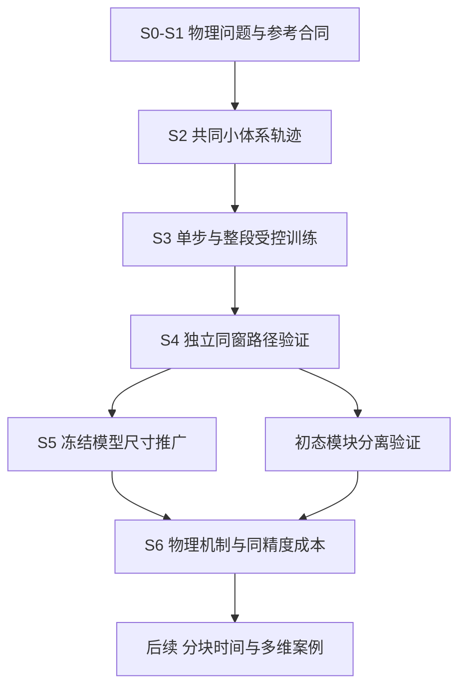

# 随机磁动力学的物理目标与路径模型决策

2026-09-17修订10覆盖：当前优先方法实现，新的物理发现暂不作为前置任务。按[架构v2](MULTISCALE_STOCHASTIC_PATH_ARCHITECTURE.md)实现多尺度条件路径块及因果接续，duration控制总时长；仍先验证有限窗口，随后将尺寸与时间推广分开再联合。下文物理问题保留为候选应用，单步／整段对照细化为[工作计划](WORK_PLAN.md)中的局部／多尺度A–D分阶段比较；无新增计算或性能结论。

_2026-09-16 · 修订9 · 依据本轮调研与讨论更新的执行计划；架构效果尚待实验。_

---

## 🎯 决策与范围

核心目标保持为：在固定磁性体系内，用小体系数据学习条件随机路径分布，在未参与训练的大体系上保留时空关联、空间机制及概率权重。当前先验证同一有限时间窗口的尺寸推广，再研究时间外推。用户接口及模型绑定信息沿用[核心合同](GENERATIVE_DYNAMICS_SCOPE.md)。

本次选择的是**优先测试整段路径生成，同时保留单步转移作受控对照**，不是预先认定整段模型更正确。“世界模型”描述学得的动力学模拟器这一功能，不是独立于单步／整段模型的第三种网络。当前不启动强化学习、通用视频预训练、跨Hamiltonian单模型或全部维度的数据生产。

近期文献支持有限温随机动力学的科学需求，但不自动证明本方法创新或可行。潜在贡献应落在小到大迁移的有效范围、集体机制的概率保真与同精度计算价值，而非“从噪声生成”“球面约束”或“世界模型”名称。

## 📊 物理问题与阶段选择

| 优先级 | 问题 | 路径统计与边界 |
| --- | --- | --- |
| 当前Bauer案例 | 局部弛豫、成核及畴壁运动如何随尺寸变化 | 条件增量、空间关联、壁密度／位置／位移；事件不足时仅报告可观测过程 |
| 当前有限窗口 | 不同初态下的转变机制与概率 | 首达／返回／未决比例、事件时间及删失；不把负终态直接叫完成翻转 |
| 后续候选 | 驱动下磁畴生长与非平衡有序化 | 畴尺寸分布、相关长度、畴壁碰撞；需另建驱动与Hamiltonian合同 |
| 后续二维案例 | 拓扑纹理扩散、成核与集体结构 | 位移分布、扩散、拓扑荷、缺陷及关联；不由一维结果代替 |
| 独立后续阶段 | 长时寿命、时间外推及三维体系 | 足够事件、正确时间标定与独立参考；本轮不承诺已实现 |

“大尺寸”应联系相关长度、畴壁宽度、成核间距和边界影响解释；增加格点数本身不是物理发现。多条小体系样本不能自动包含大体系才容纳的长波或多中心集体机制。热浴温度不唯一指定非平衡初态分布，平衡不是当前训练前置条件。

## 🧠 三类概念与代码事实

| 概念 | 学习对象 | 当前决策 |
| --- | --- | --- |
| 单步转移A | 下一物理时刻的条件分布，再滚动 | 保留、在共同数据上重训对照 |
| 整段路径B | 给定初态后的多个物理帧联合分布 | 优先开发，直接学习自旋场而非渲染图片 |
| 世界模型 | 学习系统演化并模拟未来的功能定位 | 可由A、B或分块模型实现，不另设一个比较臂 |
| 分块／Diffusion Forcing | 因果序列与不同噪声水平的生成 | 后续时间外推候选，不是本阶段门槛 |
| 潜空间模型 | 编码、隐状态演化与解码 | 先证明压缩保留物理量，当前暂缓 |

本轮已核对[局部模型](../tests/experiments/local_equivariant_transition.py)、[易轴对称封装](../tests/experiments/director_transition.py)、[采样器](../tests/experiments/projected_midpoint_sampler.py)和[训练／滚动代码](../tests/paper_work/completion/run.py)。当前展示候选是局部向量特征、两层空间Conv1d、逐点LayerNorm和条件调制，学习单lag转移；随机源是当前状态附近的归一化扰动，不是已实现纯噪声到完整轨迹。该候选没有整段物理时间编码器，也不是已验证的视频预训练模型。

网络使用邻域、易轴等结构信息，不直接消费解析有效场；不得称为没有任何物理先验。标准完整状态白噪声动力学可以用马尔可夫转移分解路径概率，滚动不是原理错误；局部裁剪或有损潜空间不自动闭合。

物理时间t、参考积分步长dt_ref与生成运输时间tau分开登记。一次联合生成仍可有多次网络调用；flow中间态不得冒充物理帧。三维空间加时间也不是普通二维RGB视频。

## 🔧 最小受控实验合同

待执行的比较只设置两个主要学习臂A/B，另保留确定性与条件Gaussian基线，以及可信真实积分参考。不删除旧模型；旧checkpoint作历史诊断，不能与使用不同新数据的B直接作唯一公平比较。

1. 先冻结同一Hamiltonian、阻尼、边界、温度支持、初态协议、训练尺寸、窗口与输出网格。窗口由关联和结构变化时间先导决定，0.8／8／32只是历史候选，不据此直接启动批量任务。
2. 用同一组小体系父轨迹构造A的状态对和B的完整窗口；先按初态来源族／父轨迹／重启祖先划分，再切片。窗口重叠不增加独立样本数。已经查看的L50/L100结果只能作开发证据，确认集须使用新来源和种子。
3. 不同噪声分支在固定完整初态和目标条件下用真实动力学生成；训练状态增强与自然初态占据分布分开，不筛成功事件、不把模型生成当真值。
4. A/B尽量共享空间特征、几何约束和条件接口，B增加时间交互。若不能严格同骨干，列出参数量、感受野和结构差异；“相同更新次数”不等于相同算力。分别报告数据匹配与计算预算匹配结果。
5. 每个主要学习臂至少三个训练seed，超参数搜索预算相当，仅用小体系开发集选模。选模指标、分组权重、容差和早停在测试揭盲前冻结，不能继续只依赖0.08终态ED。
6. 球面约束、首帧硬锚定、实际邻接／周期边界、适用协变性、随机流可复现、全窗口梯度与输出形状先做软件预检；采样积分步数收敛独立于物理时间跨度检验。
7. 初态生成器后接入。先比较真实初态＋真实动力学、真实初态＋生成动力学，再比较生成初态＋真实动力学和生成初态＋生成动力学，分离两类误差。

不默认套用视频的感知损失、强guidance或激进VAE压缩。它们可能改变概率权重或滤去物理涨落，启用前单独验证。联合路径不自动保能；有限温耗散体系也不应强制逐轨迹能量守恒。解析力辅助和统计辅助损失均单独登记消融。

## 🔍 验证、判据与失败处理

| 验证层 | 必报内容 | 不足以证明成功的证据 |
| --- | --- | --- |
| 参考与抽样 | 固定网格步长收敛、等量独立R1/R2、父轨迹层级不确定度 | 一种积分器对自身零误差 |
| 局部随机性 | 切空间增量均值／协方差、跨点关联、温度敏感性 | 多样性或范数正确 |
| 全窗路径 | 多时刻联合统计、两时相关、路径可观测量分布 | 只有终态ED或漂亮动画 |
| 空间机制 | 适用的壁密度、位置、传播、成核与结构因子 | 全局磁化自平均导致误差下降 |
| 事件 | negative_endpoint、crossed_zero、committed_switch、crossing_return、unresolved_transition | 越零当完成翻转、忽略删失 |
| 尺寸外推 | 冻结模型后同温同边界同窗、内部与边界分组 | 目标尺寸参与调参后称盲测 |
| 使用价值 | 同硬件／dtype／目标误差、调用数、峰值显存及训练摊销 | 只比较单次前向或不同精度运行 |

磁盆与驻留判据根据独立真实参考建立，不为得到事件数硬设阈值。参考和生成均无事件不证明事件概率正确；只报告有限窗界限与不确定度。未检出差异也不等于等价，确认须使用预先规定的实用误差范围和足够统计精度。

若B无稳定改善，不能只改称世界模型或持续加预算：分别诊断覆盖、时间窗、空间上下文、优化和采样误差。若A已经准确且更便宜，可保留A。若两者小体系失败，大体系只能作探索，不归因于尺寸外推。低成本是待验证主张，不是前提。

## 📋 执行依赖与文章证据

阶段执行以[工作计划](WORK_PLAN.md)为准。本次完成文档与代码事实核查，未运行新物理实验或查询实时队列。下一项可执行工作是S0/S1先导设计、旧原型复用审查及合同冻结，不是直接提交全矩阵。

论文按六组证据组织：图1问题与训练／目标域；图2参考可信度、时间尺度和状态覆盖；图3A/B方法对照与独立小体系路径；图4同窗尺寸推广与空间机制；图5可观察物理事件及其概率；图6精度—成本、数据效率和失败边界。长时寿命仅在证据足够时纳入，不靠改名替代。

新测试代码、配置、数据、日志和结果全部在tests下，验证且经批准再进入正式目录。使用zrs-mag；GPU申请rtx4090并使用cuda，CPU大任务用fat，任务名zrs-mag。未来获准提交后按约定不持续监控。本轮不改配置、不删历史结果、不提交Slurm、不暂存或推送Git；GUIDE允许推送，原始数据排除规则保持。

## 📚 本轮文献证据与借鉴边界

检索截止2026-09-16；定向调研，不是系统综述。以下记录此前本轮对话中已核对的出版社正文、方法或公开摘要，未重做每篇全文／SI复现。高水平发表证明问题受关注，不替代本项目认证，也不自动授权更换体系。

| 来源 | 核查层级与结果用途 | 不可混同的边界 |
| --- | --- | --- |
| Hardt等，Nature Communications，2025[^1] | 正文／方法；随机LLG，2万至50万自旋，驱动下畴壁和大尺度关联 | 零场Bauer不能直接复现驱动亚铁磁结论 |
| Laxamana与Hayami，PRB，2026[^2] | 期刊摘要；随机LLG区分热成核与退火生成 | 未核实具体尺寸及完整复现参数 |
| Kim等，Nature Communications，2026[^3] | 正文／方法；有限温LLG辅助解释无序光谱，9×9化学超胞 | 不是超大规模计算，也非全部量子动力学由经典LLG解释 |
| Gupta等，Nature Communications，2025[^4] | 正文／方法；1600原子、随机自旋动力学与温度／电流作用 | 不是恒温无驱动或超大尺度案例 |
| Khusyainov等，Nature Materials，2026[^5] | 出版社摘要及元数据；实验随机磁畴成核和纹理依赖翻转 | 不据摘要声称全自旋随机LLG认证 |
| Gruber等，Nature Nanotechnology，2025[^6] | 正文；实验二维斯格明子熔化和缺陷运动 | 有效温度不直接等于热浴温度 |
| de Souza Silva等，PRL，2025[^7] | 期刊摘要；自推进拓扑对的热噪声转向与反转 | 本轮未完整核查数值规模及SI |
| Brems等，PRL，2025[^8] | 期刊摘要；大时空尺度定量Thiele动力学 | 准粒子降维模型，不是全自旋LLG |
| Schrautzer等，npj Computational Materials，2026[^9] | 正文相关段；高阶交换的能量／熵与寿命 | 谐波过渡态理论，不是直接长时LLG |
| Hartmann等，Communications Physics，2026[^10] | 摘要／引言；惯性和开放系统的记忆效应 | 不扩张标准白噪声LLG的适用范围 |

方法借鉴：ITO已涉及多时间分辨率随机转移，TITO涉及体系尺寸迁移，RFM已提供几何流匹配；不能把这些概念直接当作本项目首创[^11][^12][^13]。Dreamer提供学得环境模型及想象未来的范式，不要求本项目引入策略网络[^14]。Diffusion Forcing提供因果序列与联合扩散结合的候选，不证明磁动力学长时无偏[^15]。磁力矩CNN代理已经用于可扩展LLG，但学习力矩与直接学习条件路径分布不同[^16]。

逐文献复现仍须补齐原公式、噪声约定、边界、初态、单位转换、图号与参数哈希。文献内容以原文及勘误为准；本表是证据导航，不能替代[原条件复现计划](STRICT_LITERATURE_REPRODUCTION_PLAN.md)。

## 🔗 参考文献

[^1]: Hardt et al. (2025). Propelling ferrimagnetic domain walls by dynamical frustration. Nature Communications. https://www.nature.com/articles/s41467-025-58920-1
[^2]: Laxamana and Hayami (2026). Skyrmion generation via Laguerre-Gaussian beam irradiation in frustrated magnets. Physical Review B. https://journals.aps.org/prb/abstract/10.1103/9d9c-clp5
[^3]: Kim et al. (2026). Sharp spectroscopic fingerprints of disorder in an incompressible magnetic state. Nature Communications 17, 661. 页面首次发布2025-12-06，正式版本2026-01-19。https://www.nature.com/articles/s41467-025-67394-0
[^4]: Gupta et al. (2025). Tuning ultrafast demagnetization with ultrashort spin polarized currents in multi-sublattice ferrimagnets. Nature Communications. https://www.nature.com/articles/s41467-025-58411-3
[^5]: Khusyainov et al. (2026). Texture-dependent all-optical switching in ferromagnetic films via stochastic nucleation of nanoscale domains. Nature Materials. https://www.nature.com/articles/s41563-026-02515-8
[^6]: Gruber et al. (2025). Real-time observation of topological defect dynamics mediating two-dimensional skyrmion lattice melting. Nature Nanotechnology. https://www.nature.com/articles/s41565-025-01977-2
[^7]: de Souza Silva et al. (2025). Emergent Self-Propulsion of Skyrmionic Matter in Synthetic Antiferromagnets. Physical Review Letters 135, 086701. https://journals.aps.org/prl/abstract/10.1103/c2y9-3cc9
[^8]: Brems et al. (2025). Realizing Quantitative Quasiparticle Modeling of Skyrmion Dynamics in Arbitrary Potentials. Physical Review Letters 134, 046701. https://journals.aps.org/prl/abstract/10.1103/PhysRevLett.134.046701
[^9]: Schrautzer et al. (2026). Impact of higher-order exchange on the lifetime of skyrmions and antiskyrmions. npj Computational Materials. https://www.nature.com/articles/s41524-026-02034-9
[^10]: Hartmann et al. (2026). Quantifying non-Markovianity in magnetization dynamics via entropy production rates. Communications Physics. https://www.nature.com/articles/s42005-026-02844-9
[^11]: Schreiner et al. (2023). Implicit Transfer Operator Learning: Multiple Time-Resolution Surrogates for Molecular Dynamics. https://arxiv.org/abs/2305.18046
[^12]: Viguera Diez et al. Transferable Generative Models Bridge Femtosecond to Nanosecond Time-Step Molecular Dynamics. 2025预印本摘要及后续发表信息见既有参考登记，不声称本轮逐项复核SI。https://arxiv.org/abs/2510.07589
[^13]: Chen and Lipman. Flow Matching on General Geometries. ICLR 2024. https://arxiv.org/abs/2302.03660
[^14]: Hafner et al. (2025). Mastering diverse control tasks through world models. Nature. https://www.nature.com/articles/s41586-025-08744-2
[^15]: Chen et al. (2024). Diffusion Forcing: Next-token Prediction Meets Full-Sequence Diffusion. NeurIPS. https://arxiv.org/abs/2407.01392
[^16]: Cheng et al. (2023). Convolutional neural networks for large-scale dynamical modeling of itinerant magnets. Physical Review Research 5, 033188. https://arxiv.org/abs/2306.11833
